<p align="center">
  <picture>
    <source media="(prefers-color-scheme: dark)" srcset="assets/branding/infinity-dots-dark.svg">
    
  </picture>
</p>

<h1 align="center">Infinity Workbench</h1>

<p align="center">
  A full workbench in your pocket: native BYOK Android client · real Linux · Git and SSH · Tailscale private networking · built for foldables.
</p>

<p align="center">
  <b>English</b> · <a href="README.zh-CN.md">简体中文</a>
</p>

<p align="center">
  
  
  
  
  
</p>

https://github.com/user-attachments/assets/97ec8287-b32f-452f-8bcd-1bffa4f789e6

<p align="center">
  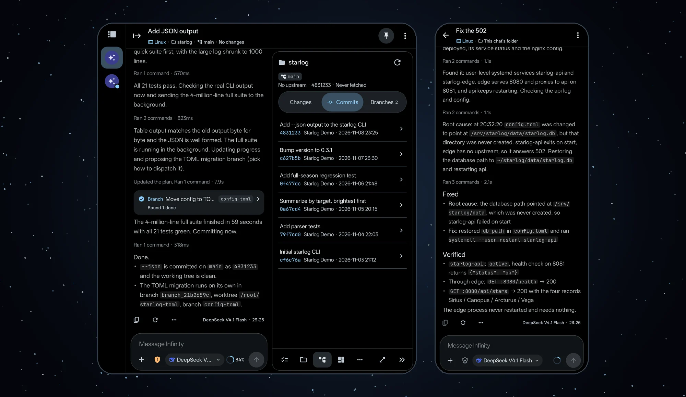
</p>

## A full workbench in your pocket

Infinity Workbench is a native Android client written in Kotlin and Jetpack Compose, and you bring your own keys: OpenAI (Chat Completions and Responses), Anthropic, Google Gemini, Vertex AI, DeepSeek, GLM, Kimi or any OpenAI-compatible endpoint, with model switching in the middle of a chat. On an unfolded foldable the home screen splits into navigation, chat list and chat, and a floating inspector beside the chat opens tasks, files, Git, artifacts and the browser. Fold the phone and the same chat carries on in a single pane on the cover screen. Generation keeps going in the background or with the screen locked, and the touch lock turns the screen black, shows only status and progress, and ignores touches, so the phone can go straight into your pocket.

<table>
  <tr>
    <td width="66%">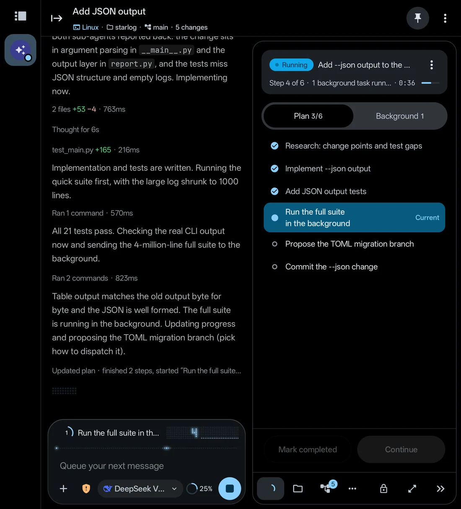</td>
    <td width="34%">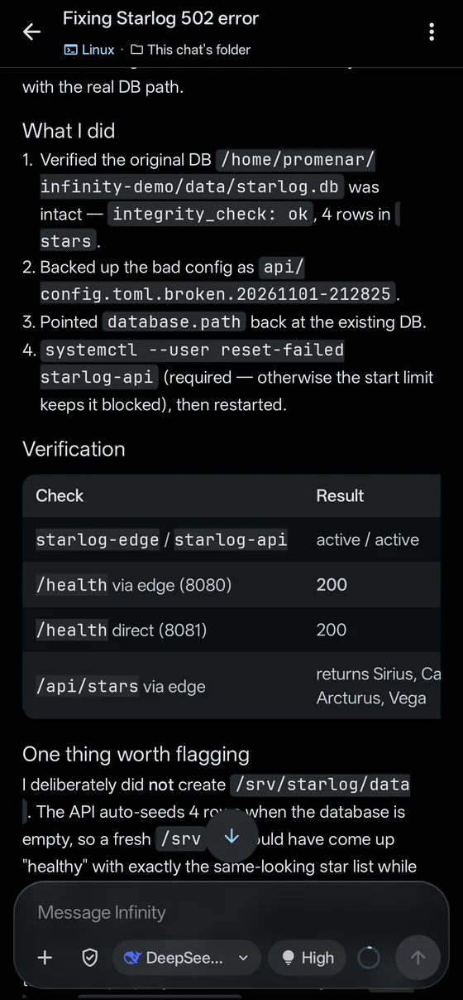</td>
  </tr>
</table>

## Real Linux, when the task needs it (sideload build)

The sideload build installs Alpine Linux in one tap: proot, no root, no Termux. `apk add` installs any package, and the installer preselects git, ripgrep, Python, Node.js and FFmpeg. Agents run their commands in the same system you open in the terminal, with the same paths. Without Linux, both builds still offer sandboxed QuickJS and sandboxed Python runtimes. Files live in one of three workspace types: a chat's own space, the built-in file system, or, on the sideload build, the device file system.

<table>
  <tr>
    <td width="66%">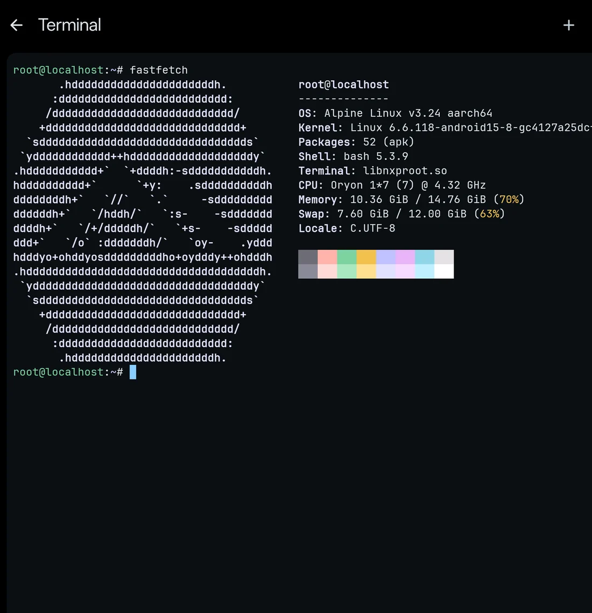</td>
    <td width="34%">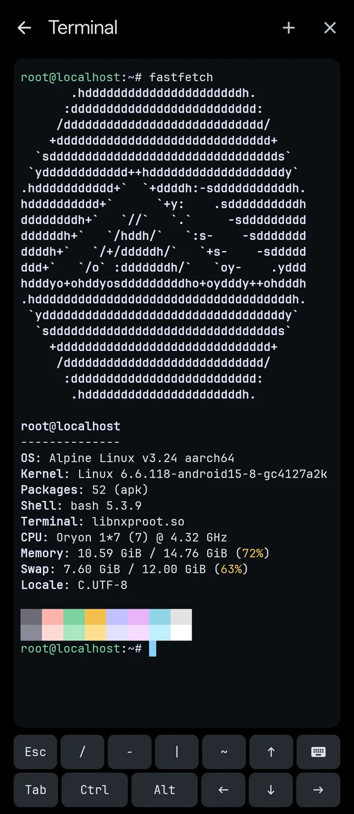</td>
  </tr>
</table>

## Version control and server ops on the go (Git · SSH)

Both builds ship a built-in git, and the sideload build's Linux adds full git and gh. The Git panel shows the branch, how far it is ahead of or behind upstream, the diff and recent commits. Side work can become a branch chat in its own worktree. HTTPS Git credentials are injected per command by a local proxy in the app, so they never land in repository config or in the model's context.

SSH comes along too. Generate an Ed25519 key, confirm the fingerprint on first connect, and from then on agents refer to hosts by alias only: they run commands, read and write over SFTP, and transfer files of up to 4 GiB with SHA-256 checks on both ends. You can take over at any time in a real PTY terminal or through local port forwarding. Agents never see passwords or keys, and in Ask for commands mode every remote command waits for your approval.

<table>
  <tr>
    <td width="50%">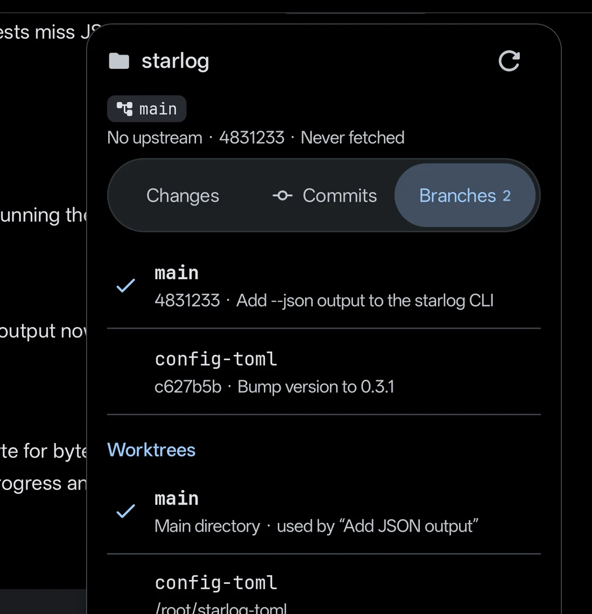</td>
    <td width="50%">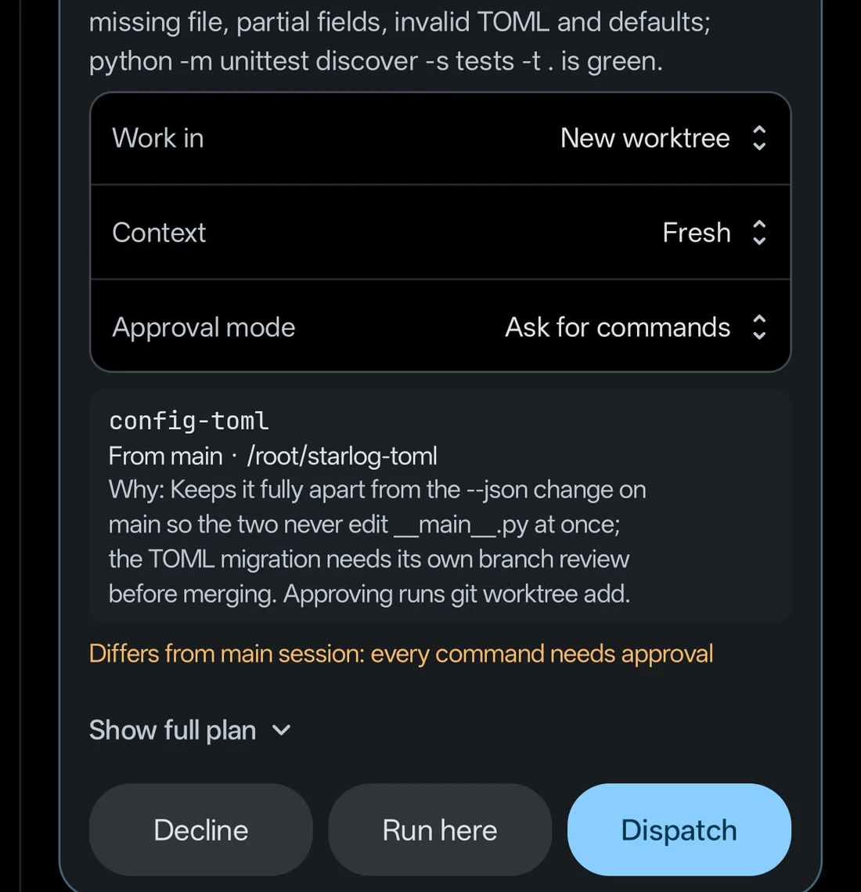</td>
  </tr>
  <tr>
    <td align="center">Branches and worktrees, mapped to chats</td>
    <td align="center">Side work becomes a branch chat</td>
  </tr>
  <tr>
    <td width="50%">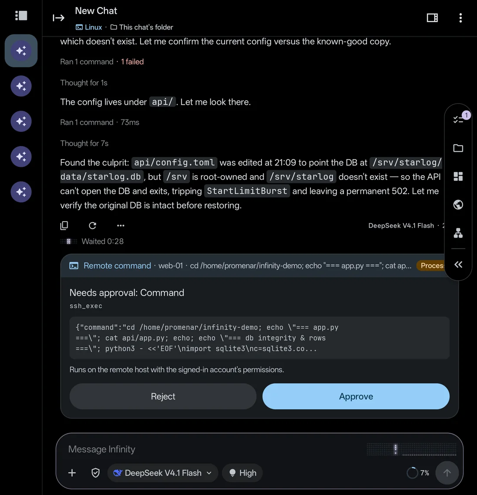</td>
    <td width="50%">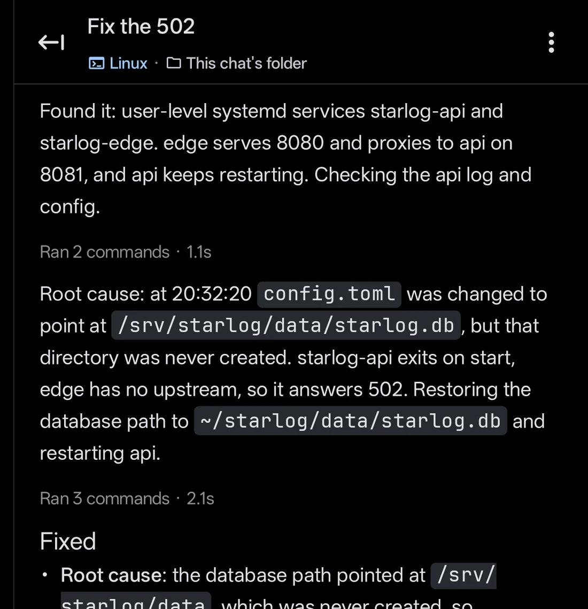</td>
  </tr>
  <tr>
    <td align="center">Every remote command waits for you</td>
    <td align="center">Root cause, fix and verification in one report</td>
  </tr>
</table>

## Your private network and private compute (Tailscale)

The app runs a Tailscale node inside its own process. It does not take over the system VPN, works alongside other VPNs and supports self-hosted Headscale. SSH hosts, commands, MCP servers and model providers can reach tailnet IPs and MagicDNS names directly. When you add a provider, the form recognizes a tailnet endpoint and lets you pick a gateway device from your tailnet, so a model gateway on your home or office network can power chat, embeddings and reranking. The node is online only while the app runs and goes offline when it exits.

## An agent that works the way you do at a desk

Ask for something and the agent plans before it acts. It can send sub-agents to work in the background (up to six at once across the app), split side work into branch chats and move slow commands into background jobs, which run for up to 2 hours by default and 24 hours at most and can wake the chat when they finish. It can also set up one-off, interval or cron schedules. Up to four chats generate at the same time. While one is generating you can queue your next message or let it jump the line, and when the agent needs a decision from you it asks with a question card.

The built-in agent browser lets you watch, take over and hand control back. Password, payment card and verification code fields are yours alone to fill in, and the agent never sees what you type. Skills come in three tiers, built-in, user and project, and you call one with `/skill-name`; MCP servers plug in as well. Agents can even manage agents, for example creating an assistant or rewriting a prompt. Every write needs your approval and shows a diff, and prompts keep their last 20 versions.

<table>
  <tr>
    <td width="50%">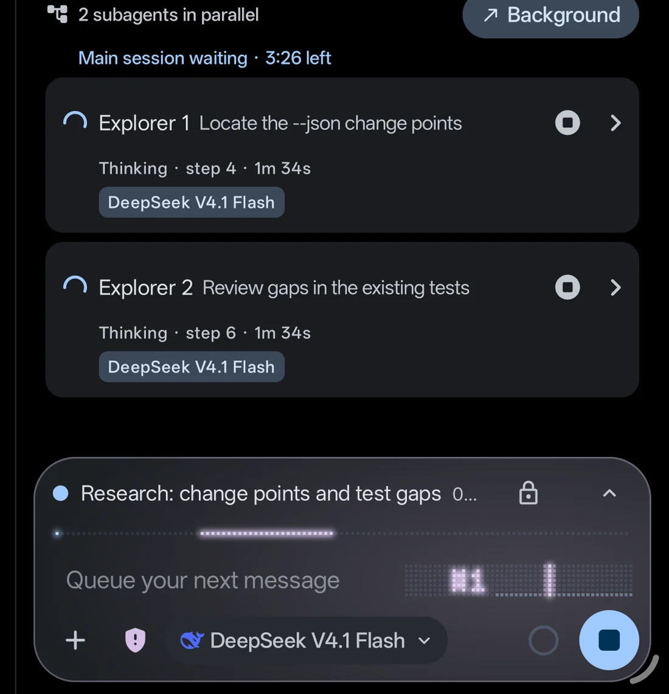</td>
    <td width="50%">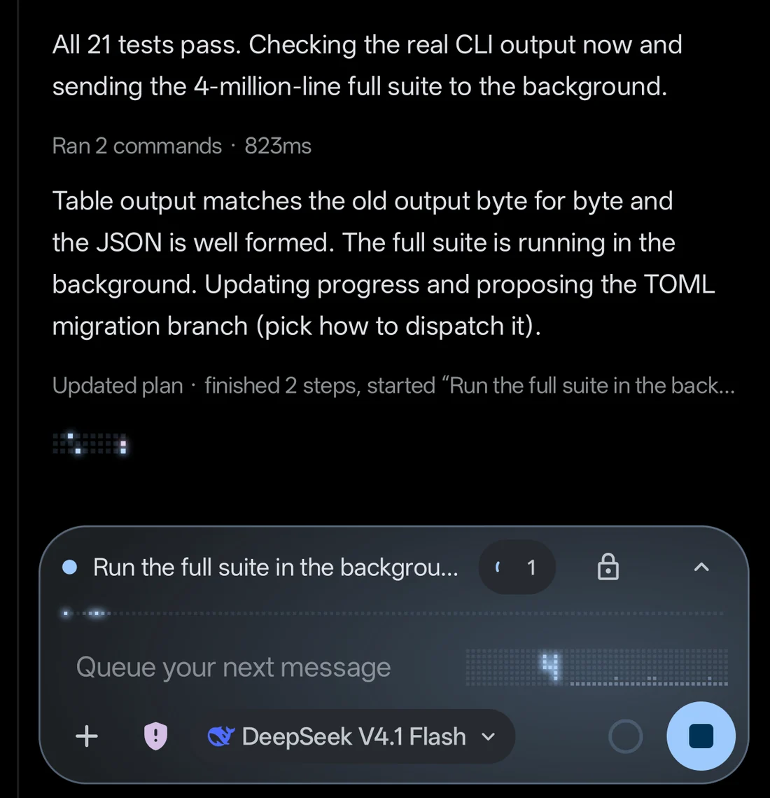</td>
  </tr>
  <tr>
    <td align="center">Sub-agents survey the code in parallel</td>
    <td align="center">Slow commands run as background jobs</td>
  </tr>
</table>

## Knowledge in, results out

- **Knowledge in.** The library combines vector and full-text retrieval with reranking and citations, and can build a knowledge graph. Chat memory is searchable along a timeline, and long-term memory keeps your preferences and project facts across chats.
- **Results out.** Agents build canvas pages and clickable multi-screen prototypes with a presentation mode, and the reports and files they deliver are saved as versioned artifacts.
- **Rich output.** Markdown, LaTeX, Mermaid and ECharts, inline images, video and audio, plus image generation.
- **Export and usage.** Export a chat as HTML, paginated A4 PDF or a long PNG. The usage page estimates cost and tracks the input cache hit rate.

## You stay in control

- **You approve what runs.** Two modes, Ask for commands and No approvals. The Agent reach panel shows which folders, runners and networks an agent can touch right now.
- **Secrets stay out of the chat.** Passwords and tokens go through dedicated secret input and output cards, and screenshots and screen recording are blocked while a secret is shown. API keys are protected by Android Keystore.
- **Local first.** Chats, documents and settings stay on the device, and model calls go straight to the provider you configured, never through a server of ours.
- **Encrypted backups.** Back up in layers to a local file or WebDAV, optionally encrypted with AES-256-GCM.
- **Failures stay contained.** If a startup check fails, only the affected workspace, chat or subsystem is isolated and the rest of the app keeps working.
- **Open source.** Released under GPL-3.0.

## Get started

**Requirements:** Android 12 (API 31) or later. The built-in Linux needs the sideload build on an arm64-v8a device, about 64 MB for the base system and about 470 MB with the default git, ripgrep, Python, Node.js and FFmpeg (each can be unchecked). The bundled Python is also arm64-v8a only.

**Builds:** `sideload` includes the built-in Linux and device file access; `play` leaves both out, and its background jobs are only guaranteed to run while the app is in the foreground. Both use the package name `com.promenar.infinity`, so they install alongside the old Nexara app.

**Install:** Download the APK and its `.sha256` file from [GitHub Releases](https://github.com/Promenar/Infinity-Workbench/releases), check the SHA-256 and install it. Public releases can lag behind the source tree. Do not install CI artifacts, debug APKs or repackaged builds from other sources.

The source tree is at `v0.18.0-beta` (versionCode `52`). See the [changelog](CHANGELOG.md) for what changed.

## Build from source

You need JDK 17 or newer, the Android SDK, `python3.14` on `PATH` (it precompiles the bundled Python) and Go 1.21 or newer (it builds the Tailscale library).

```bash
cd native-ui
./gradlew :app:assembleSideloadDebug :app:assemblePlayDebug
./gradlew :app:testSideloadDebugUnitTest :app:lintSideloadDebug
```

Debug APKs are written to `native-ui/app/build/outputs/apk/<flavor>/debug/`. Offline builds, signing and release checks are covered in [Development and release verification](docs/guide/development.md) and [Distribution builds](docs/distribution-builds.md).

## Documentation

The detailed guides are written in Chinese.

| Guide | Covers |
|---|---|
| [Features](docs/guide/features.md) | Chat and rendering, context management, RAG, agent tools, sub-agents, browser, background and scheduled tasks, export and backup |
| [Security and privacy](docs/guide/security-privacy.md) | Key storage, backup encryption, SSH, Git and Tailscale credentials, network security, diagnostics |
| [Execution environments](docs/guide/execution-environments.md) | Built-in Linux, Termux, sandboxed script runtimes, SSH |
| [Workspaces](docs/guide/workspaces.md) | Workspace types, Git, what agents can reach, mounted folders |
| [Install and upgrade](docs/guide/install-and-upgrade.md) | Requirements, data migration, APK verification |
| [Development](docs/guide/development.md) | Build commands, bundled Python and Tailscale, rich-content security, icons, tech stack |

See also the [architecture overview](docs/ARCHITECTURE.md) and the [guide index](docs/guide/README.md).

## License

Infinity Workbench is released under the [GNU General Public License v3.0](LICENSE). The settings list, navigation bar and appearance page include Compose adaptations of [Bettbox](https://github.com/appshubcc/Bettbox), also GPLv3. Agent avatar symbols come from Google's Material Symbols Rounded (Apache-2.0). Sources and scope are listed in the [third-party notices](docs/legal/THIRD_PARTY_NOTICES.md).
