<p align="center">
  
</p>

<h1 align="center">Infinity Deck</h1>

<p align="center">
  <b>An open-source, local-first AI agent workbench on Android.</b><br>
  Alpine Linux container, Git, SSH, built-in Tailscale, on-device speech &amp; GGUF inference, hybrid RAG, and a media production pipeline in a single app.<br>
  Bring your own API key or local models. Your data and credentials stay on the device.
</p>

<p align="center">
  <b>English</b> · <a href="README.zh-CN.md">简体中文</a>
</p>

<p align="center">
  <a href="https://github.com/Promenar/Infinity-Deck/releases"></a>
  <a href="https://infinityware.work"></a>
  
  
</p>

**Infinity Deck** is an open-source AI workbench for Android 12+, combining multi-agent orchestration, on-device shell and code execution, private tailnet connectivity, offline speech transcription, a local knowledge base, and multimedia production workflows:

- **Local execution layer**: One-tap rootless Alpine Linux (`arm64-v8a`, with `git`, `ripgrep`, Python, Node.js, and FFmpeg) alongside built-in Python 3.14, QuickJS, and a trimmed `arm64-v8a` FFmpeg/ffprobe toolchain — run scripts, process media, build projects, and transform files directly on the phone without keeping a remote desktop host awake.
- **Models and on-device inference**: Connect major cloud APIs and Coding Plan presets with your own keys, or run `llama.cpp` GGUF inference locally (independent `MAIN`, `EMBEDDING`, and `RERANK` slots with `16K / 8K / 4K` Prefix KV Cache) and an on-device `sherpa-onnx` speech pipeline (`X-ASR` streaming, two-pass `SenseVoice-Small int8` refinement with RAM-tier gating and RTF backoff, and speaker diarization).
- **Private networking and remote ops**: Embedded userspace Tailscale node (compatible with self-hosted Headscale) that never occupies Android's system VPN slot — routing SSH, self-hosted LLM gateways, ComfyUI, MCP servers, and the built-in browser straight onto your `tailnet`.
- **Knowledge & creative workspace**: Mount device folders with `read_only / read_write` scoped permissions, query chunked vector search + cross-session memory + per-work knowledge graphs with numbered citations, export rich-format recordings (tables, Mermaid, ECharts, LaTeX, unbounded PNG/PDF), generate clickable web prototypes, paint inpainting masks for ComfyUI, and run short-film production with offline `Three.js` 3D previs and on-device MP4 + SRT export.

## Contents

- 🧭 [Architecture & Runtime Behavior](#architecture--runtime-behavior)
- ✨ [Core Workflows](#core-workflows)
- 🔒 [Security & Data Boundaries](#security--data-boundaries)
- 🚀 [Install & Build](#install--build)
- 🧰 [Capabilities](#capabilities)
- 💬 [FAQ](#faq)
- 📚 [Documentation](#documentation)
- 🤝 [Contributing](#contributing)

## Architecture & Runtime Behavior

- **Standalone on-device execution**: Command execution, Git repository operations, document parsing, and local model inference run directly on the phone; offload heavy workloads to home workstations or GPU hosts over SSH and Tailscale whenever they are online.
- **Multi-protocol model routing**: Native adapters for OpenAI Responses / Chat Completions, Anthropic Messages, Google Gemini / Vertex AI, DeepSeek, and OpenAI-compatible gateways, with mid-chat model switching and per-model connectivity probes.
- **Zero public exposure for private services**: Embedded Tailscale connects app traffic straight to private `tailnet` peers with no public port forwarding and no system VPN conflicts.
- **Human-in-the-loop controls**: Upfront execution plans, per-command approval cards, structured `ask_user` prompts, background job tracking, and message queueing/steering.
- **Adaptive foldable & tablet layout**: Three-column workspace (`Navigation · Chat List · Conversation`) on inner screens with a docked/expandable obsidian inspector and swipeable tabs; folds seamlessly to the cover screen with a 93% obsidian frosted drawer and preserved scroll and composer state for one-handed review.

## Core Workflows

<p align="center">
  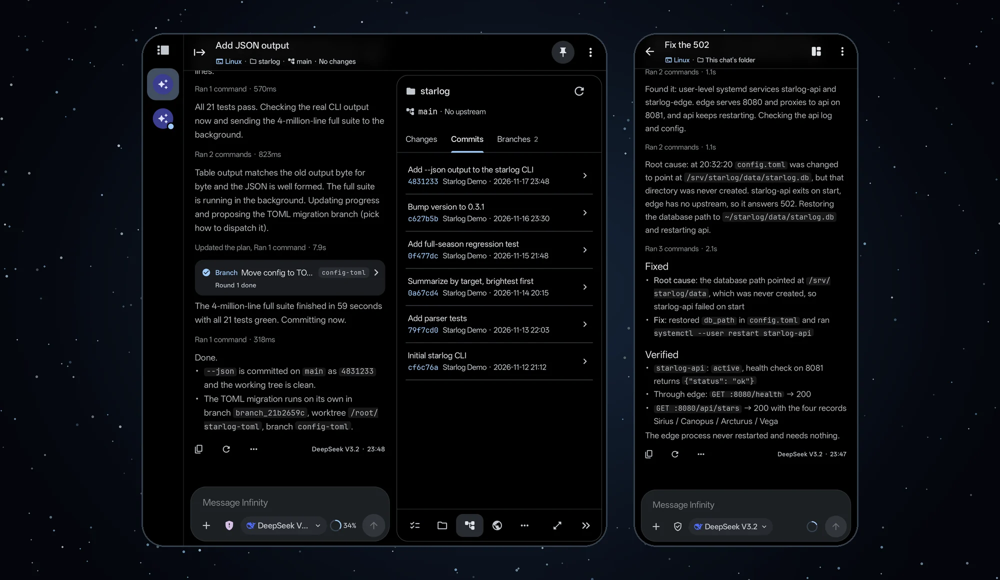
</p>

<table>
  <tr>
    <td width="50%" valign="top">
      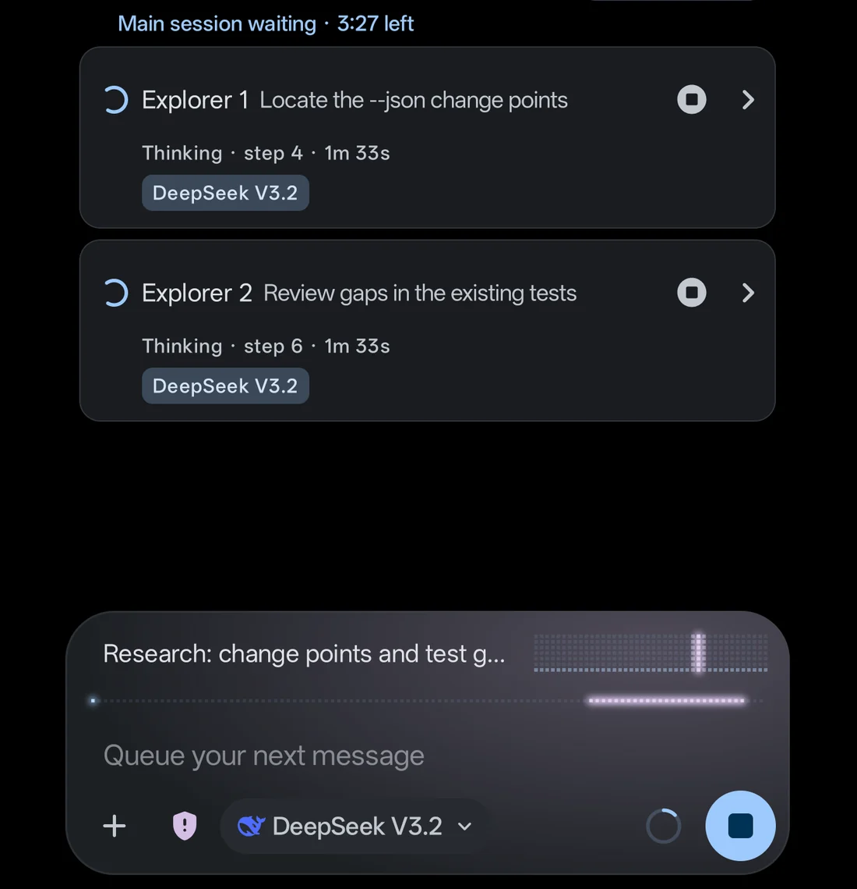
      <h3>Task Planning &amp; Parallel Sub-Agents</h3>
      Before tackling complex tasks, the agent lays out step-by-step plans and spawns parallel read-only or scoped sub-agents (up to 32 active per chat, 8 per dispatch) to search codebases, check references, or review tests, returning structured findings and timings automatically.
    </td>
    <td width="50%" valign="top">
      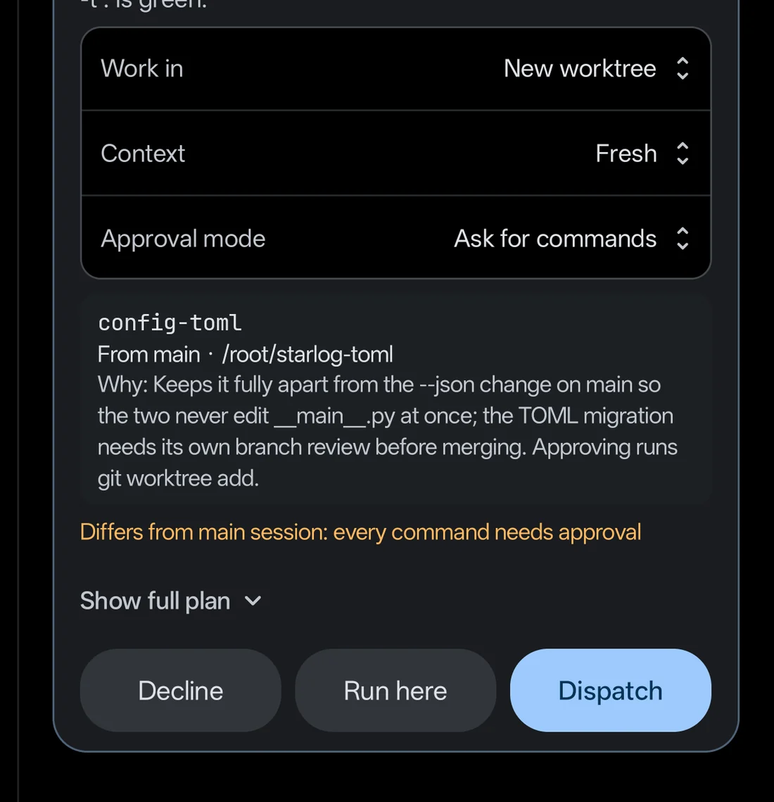
      <h3>Git Worktrees &amp; Isolated Branch Chats</h3>
      Fork side tasks into branch chats bound to isolated Git worktrees. Main and branch sessions edit files and run test suites in parallel without stepping on each other, inspected through the built-in Git panel for diffs, branches, and commit history.
    </td>
  </tr>
  <tr>
    <td width="50%" valign="top">
      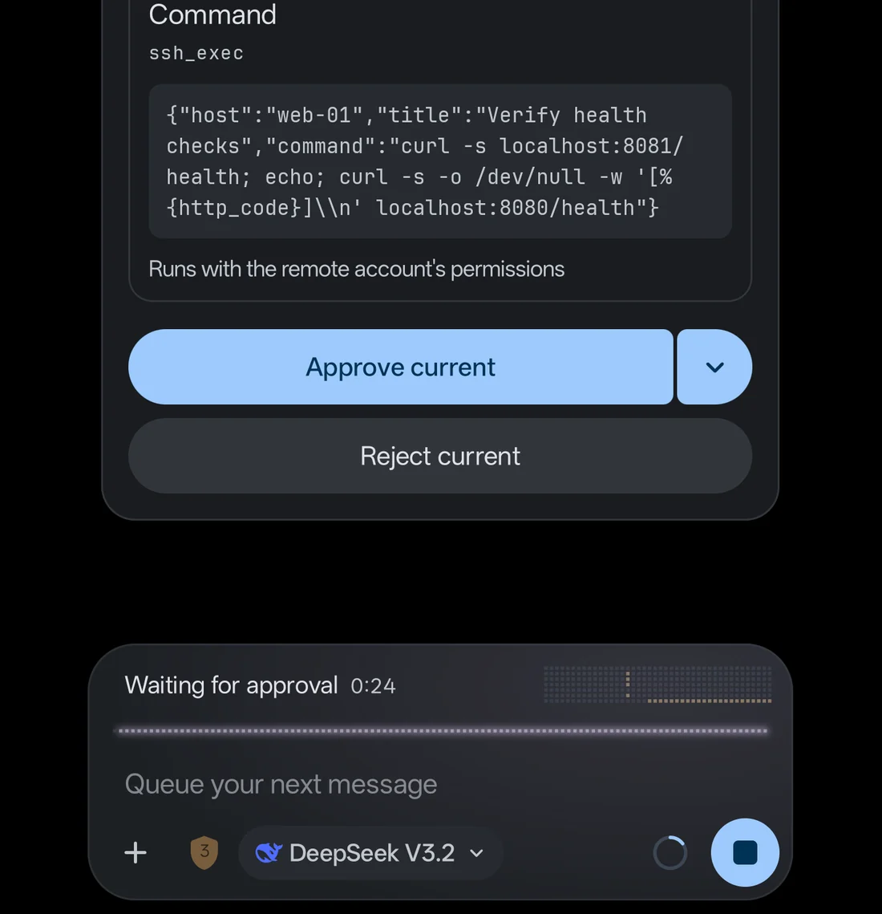
      <h3>SSH Remote Execution &amp; Command Approval</h3>
      Connect over SSH to inspect failing hosts. In default approval mode, every command displays the target host, exact arguments, and execution context for confirmation before running, producing a clean incident summary afterward.
    </td>
    <td width="50%" valign="top">
      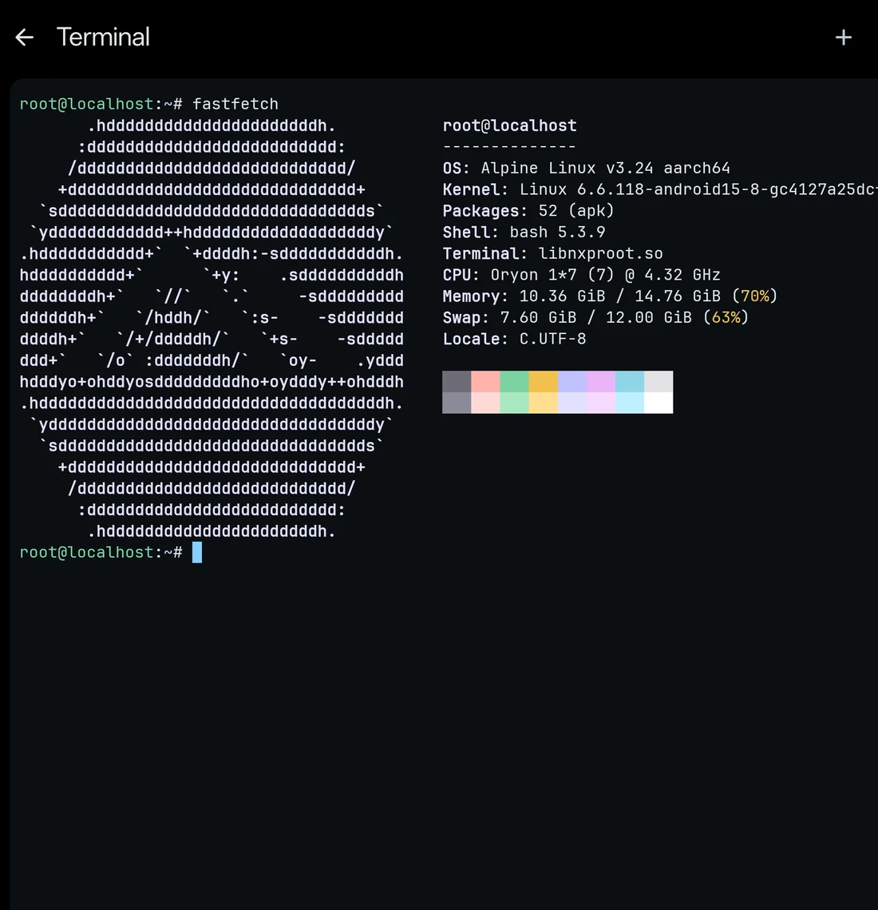
      <h3>Built-in Rootless Alpine Linux</h3>
      Deploy an `arm64-v8a` Alpine Linux userland in one tap with no root and no external Termux. Run Python, Node.js, FFmpeg, Git, or extend the environment with `apk add`.
    </td>
  </tr>
  <tr>
    <td width="50%" valign="top">
      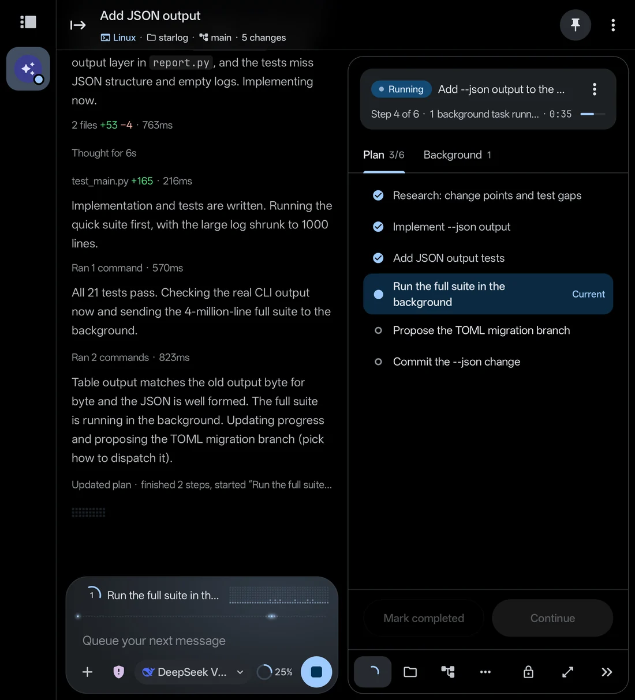
      <h3>Foldable Workbench &amp; Pinned Inspector</h3>
      Unfolded screens switch to an adaptive multi-column workspace (`Navigation · 40dp circuit branch rail or chat list · Conversation`) paired with an obsidian frosted-glass inspector housing tasks, files, Git, browser, remote tools, and the production panel on a scrollable short-label strip.
    </td>
    <td width="50%" valign="top">
      <p align="center">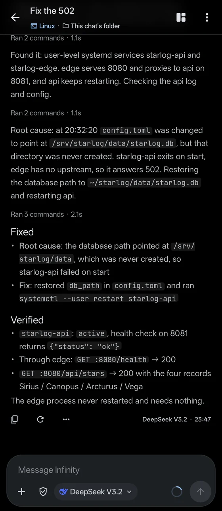</p>
      <h3>Seamless Fold/Unfold Continuity</h3>
      Fold the device and the active chat transitions to the cover screen with scroll position and draft state intact for one-handed review, command/lock approval taps, floating notice capsules, or quick follow-up prompts.
    </td>
  </tr>
  <tr>
    <td width="50%" valign="top">
      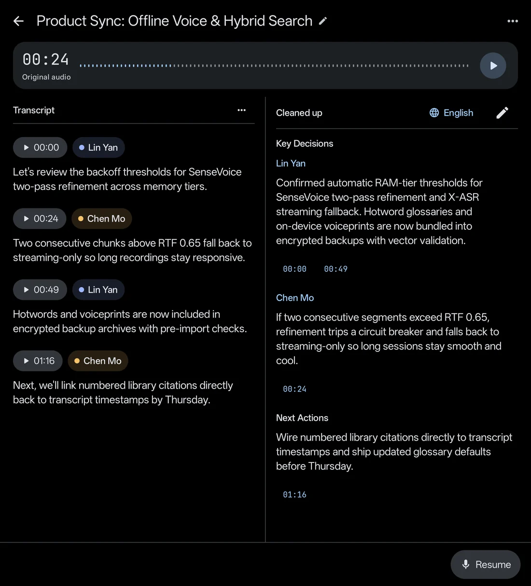
      <h3>Offline Speech &amp; Recording Cleanup</h3>
      On-device streaming dictation (`X-ASR`), optional `SenseVoice-Small int8` two-pass refiner (with RAM-tier sizing and RTF circuit-breaker fallback), and local speaker diarization (`pyannote + CAM++`), producing live drafts, rich-format Markdown notes (GFM tables, Mermaid, ECharts, LaTeX), dual Edit/Preview editing, `/mnt/knowledge` CAS sync, and `1440px+` PNG/PDF export.
    </td>
    <td width="50%" valign="top">
      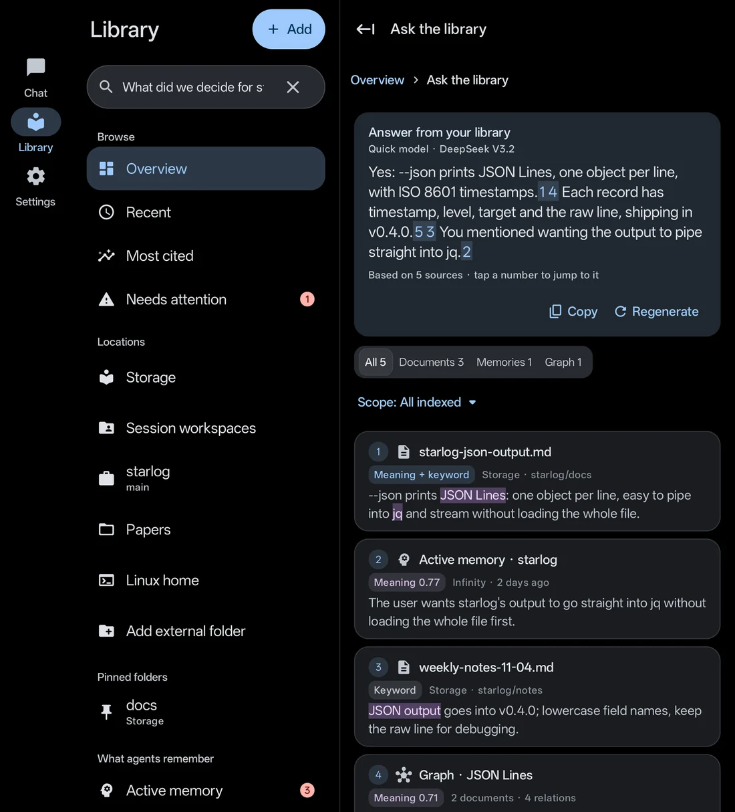
      <h3>Hybrid RAG Library &amp; Knowledge Graph</h3>
      Import PDF, Word, Markdown, and HTML files or mount folders with `read_only / read_write` approval tiers. Combines vector + keyword search, cross-session long-term memory, and entity knowledge graphs to generate cited answers jumping straight to highlighted passages.
    </td>
  </tr>
  <tr>
    <td width="50%" valign="top">
      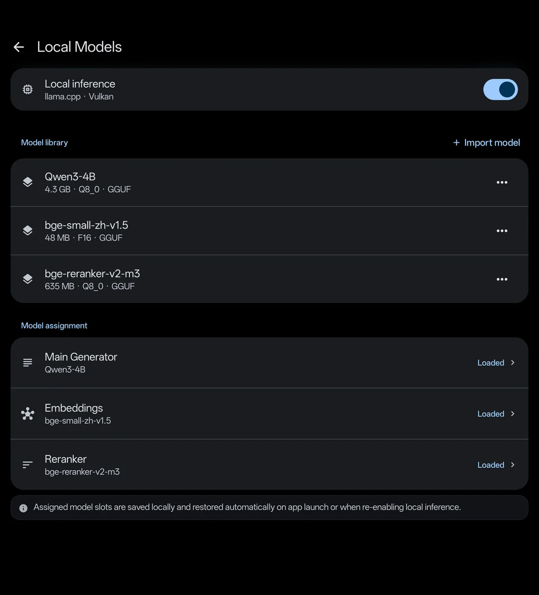
      <h3>Model Routing &amp; On-Device GGUF</h3>
      Connect cloud providers and Coding Plan presets alongside `llama.cpp` GGUF inference managing three independent slots (`Main`, `Embedding`, `Rerank`) with automatic restart recovery and Tailscale private gateways in the unified picker.
    </td>
    <td width="50%" valign="top">
      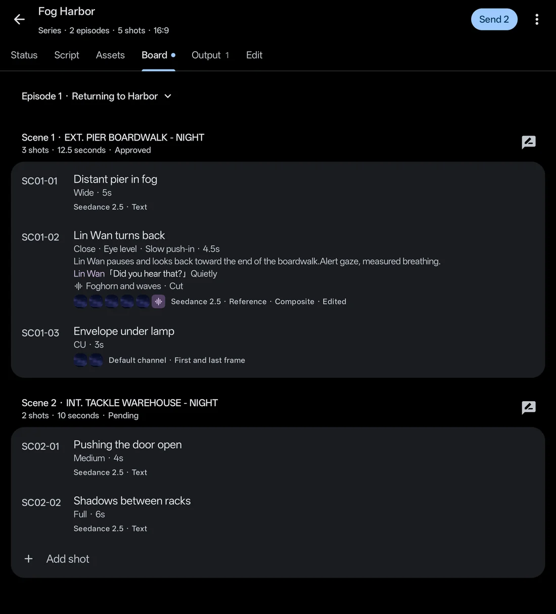
      <h3>Canvas Prototypes, 3D Previs &amp; Film Panel</h3>
      Build clickable multi-screen web prototypes, generate or inpaint images via cloud APIs or ComfyUI with a 1×–5× / 90° swipeable lightbox gallery, and run scripts, dual-mode visual assets, locked-item approvals, offline `three.js` 3D storyboard previs (Beauty/Depth frame capture &amp; hardware MP4 export), and multi-channel video rough-cuts.
    </td>
  </tr>
</table>

## Security & Data Boundaries

- **Risk-based approval gates & catastrophic root-wipe hard-block**: In default **Approve by risk** mode, strictly parsed zero-side-effect read-only shell commands run directly while write/exec commands, file deletions, and outside-workspace writes prompt for confirmation; **No approvals** skips routine L1 actions while runtime/governance mutations (skills, agent config, ComfyUI/SSH/schedule configs) still require confirmation in both modes. Destructive root-wipe commands targeting `/`, `/sdcard`, `/storage/emulated/0`, app data roots, or unexpanded root variables are unconditionally blocked in both modes without an approval prompt.
- **Credential isolation from LLM context**: Passwords and tokens are entered via dedicated secret-input cards (`FLAG_SECURE` screenshot blocking enabled) straight into encrypted storage, never written into chat history or model prompts.
- **Android Keystore keychain**: API keys, SSH private keys, Git tokens, and site credentials are encrypted on device; plaintext reveal requires biometric or lockscreen verification, auto-hides after 30 seconds, and clears the clipboard after 60 seconds.
- **Local storage & direct requests**: Chat databases, RAG indexes, recordings, and preferences stay on the phone; LLM requests travel directly from the device to your configured endpoint with no intermediary proxy.
- **Encrypted backups**: Export encrypted local backup archives (including optional voiceprint and credential recovery) or sync via WebDAV.
- **Open-source license**: Released under GPL-3.0.

## Install & Build

### Prebuilt APK

1. Download the signed `.apk` and matching `.sha256` file from [GitHub Releases](https://github.com/Promenar/Infinity-Deck/releases/latest) or the [official download page](https://infinityware.work/en/download/).
2. Verify the SHA-256 checksum before installing (install only official Releases packages; avoid temporary CI artifacts or third-party repacks).
3. Launch the app, configure your cloud API keys in Settings, or download the built-in Linux environment, offline ASR models, and local GGUF models as needed.

- **Requirements**: Android 12 (API 31) or later. Built-in Linux and on-device GGUF inference require `arm64-v8a`; Alpine base occupies ~64 MB, or ~470 MB with the default toolchain (`git`, `ripgrep`, Python, Node.js, FFmpeg, each optional at install time).
- **App updates**: Check **Settings › About › Check for updates** to query the latest GitHub Release and open the download page; nothing downloads or installs silently in the background.
- **Current version**: `v0.74.1-beta` (`versionCode` `219`), adding manual drag-to-reorder in Built-in Proxy **Fallback order** mode (right-edge drag handle for immediate vertical drag + long-press row drag, live `#1/#2` priority updates, lifted active card with boundary clamping, smooth edge auto-scroll for long subscriptions, single atomic commit on drop, plus Move to top / Move up / Move down in the tap menu and TalkBack custom actions); builds on `v0.74.0-beta` (`218`), introducing a standalone user-space **Built-in Proxy** (`libnxproxy.so`, Sideload & Play dual-channel, zero system `VpnService`, zero RAM when off) with loopback-only per-run HTTP/SOCKS5 auth, encrypted YAML/Base64 subscription & share-URI import, single-node & ranked fallback outbound modes, batch latency testing, an in-app Advanced YAML editor with pre-save kernel validation, per-provider opt-in routing (`Connect via built-in proxy`, default direct with strict no-fallback fail-closed semantics), automatic public routing for the built-in browser and Agent web tools, Tailscale P2P coexistence (Tailnet/LAN/loopback always direct), and on-demand Alpine Linux `$INFINITY_PROXY_*` injection without hijacking global `HTTP_PROXY`; also streamlines Appearance color styles into 3 clear hue-preserving tiers (**Soft / Standard / Bright**), synchronizes all 5 generation motion phases (`WAIT / STREAM / TOOL / APPROVAL / RETRY`) across the RunDock dot-matrix, divider LED strip, glass/ambient wash, composer glows, and inline indicators, and isolates `LocalRowHeightGroup` across all overlays to eliminate parent card height-jump when opening option sheets; builds on `v0.73.7-beta` (`217`), adding the **Bright (`BRIGHT`)** color style in Appearance Settings (locking the chosen seed hue without hue drift while lifting dark-mode primary accents out of washed-out pastels into luminous high-chroma tones and preserving vivid light-mode accents with adaptive foreground contrast) and unifying the top-right `+` primary button across both **Chat** and **Library** headers onto a shared `34dp` circular `primary / onPrimary` `InfinityTabHeaderCircleAction`; builds on `v0.73.6-beta` (`216`), fixing `LibraryNoticeEffect` so consuming a one-shot `LibraryNotice` no longer cancels `snackbar.showSnackbar(...)` on the next recomposition frame (restoring reliable feedback for workspace reference blocks, deletions, unlinks, and unpins); builds on `v0.73.5-beta` (`215`) reorganizing Library › Files into four explicit sections (**Built-in** with Alpine Linux Home visibility tied to installation state, **App workspaces** auto-hiding when empty, **External paths** with trailing Add external folder action, and **Pinned** shortcuts) while preserving the clean trailing chevron, adding dual-entry obsidian context menus (long-press rows + workspace root overflow `⋮`) with one-step symlink-safe app workspace deletion (and registration-only unlink for shared storage/external mounts), hiding redundant root "Pin" actions, enriching Folder/Item details with origin, full canonical monospace path, reference counts, and one-tap Copy path, and fixing ComfyUI Settings `Tailnet` pill clipping on narrow cover screens; builds on `v0.73.4-beta` (`214`) Linux background job keep-alive contracts and runtime reliability (completing `LINUX_SHELL_GUIDANCE` & `background-processes.md` cross-turn survival and built-in browser `127.0.0.1` callback handoff rules, normalizing empty `stdin` in Linux PTY mode, promoting yielded foreground runs to `background=true`, surfacing FGS start warnings, bounded 10-minute renewable `PARTIAL_WAKE_LOCK` leases, and sanitized `job.start`/`job.end` diagnostics); builds on `v0.73.3-beta` (`213`), which brought `AttachmentActionMenu` and all remaining custom overlays (`GenerationStatsPopup`, `BackgroundJobLogDialog`, `LibraryNoteDialog`, onboarding `InfinityModalSheet` flows, and ComfyUI editor dialogs) onto the unified 4-step obsidian system while eliminating all stray raw `AlertDialog` / `ModalBottomSheet` calls; builds on `v0.73.2-beta` (`212`) explicit `onSurface` `contentColor` propagation, `v0.73.1-beta` (`211`) portrait drawer z-order / `statusBarsPadding()` fix, and `v0.73.0-beta` (`210`), which unified all three Chat Inspector form factors (zero-blur obsidian docked `360dp` pane, live frosted `560dp` / full-width overlay drawer, and an in-window `93%` obsidian frosted portrait drawer) with outer `HorizontalPager` swipe navigation across inspector tabs, aligned all 8 inspector pages onto a strict two-tier header (`4dp + 56dp` B-tier / `4dp + 48dp` A-tier) and sticky `InfinityPanelTabs` coordinate system (upgrading `Canvas` to sticky tabs + pager and fixing Inspector system-bar inset leakage in `InfinitySettingsPageLayout`), and rolled out a full-site 4-step obsidian overlay system across sheets, centered panels, confirm dialogs, popovers, dropdown menus, and approval cards. Built on `v0.72.4-beta` (`209`) pure docked + full-height overlay inspector refactor, `v0.72.3-beta` (`208`) unified `16dp` `InfinitySettingsPageLayout` top content padding across unfolded two-pane and phone Settings screens, `v0.72.2-beta` (`207`) `1dp` top specular rim stroke alignment on floating frosted-chrome surfaces, and `v0.72.1-beta` (`206`) & `v0.72.0-beta` (`205`), which unified built-in mode onto a single real Android filesystem path system (sharing canonical paths across file tools, `shell_exec`, `python_exec`, and media with portable no-leading-`/` workspace-relative paths and bidirectional `/data/data` ⇄ `/data/user/0` + `/sdcard` alias protection while keeping virtual prefixes only for non-POSIX `/mnt/knowledge` and SAF mounts), opened read-only self-diagnosis on critical runtime data while hard-blocking encrypted secret storage (`infinity_encrypted_secrets.xml*`), introduced the L1/L2 risk-based approval model (`Approve by risk` / `No approvals`) with a strict POSIX-parsed zero-side-effect read-only shell allowlist, and added a non-approvable hard-block (`EXEC_BLOCKED_CATASTROPHIC_COMMAND`) against destructive root-wipe commands in both modes. Earlier `v0.71.6-beta` (`204`) unified built-in `arm64-v8a` FFmpeg/ffprobe `PATH` symlink exposure and added `references/runtime-isolation.md` to the pre-installed `infinity-deck` builtin skill; `v0.71.5-beta` (`203`) upgraded Infinity Deck's ComfyUI compatibility layer into a zero-hardcoding universal submitter framework with dual-runtime auto-switching (Linux / built-in Python 3.14), bundled trimmed `arm64-v8a` FFmpeg 9.1 + ffprobe + 8-bit `libx264` (`+2.69 MiB` APK delta, 16KB page-aligned, GPL-3.0), 10 generic configurable submitter capabilities, and closure of all 3 `STATEFUL_CHAIN` verification/observability/ancestor-protection gaps; `v0.71.0-beta` (`198`) built on the latest public GitHub release `v0.70.4-beta` (`versionCode` `196`) to introduce the independent ComfyUI compatibility layer and 14 Agent-First `comfy_*` tools. Full version-by-version history is in [CHANGELOG.md](CHANGELOG.md) and [Releases](https://github.com/Promenar/Infinity-Deck/releases).

### Build from Source

Requires JDK 17+, Android SDK (API 36 / Build Tools 36.0.0 / NDK / CMake 3.22.1), `python3.14` on `PATH` (for precompiling the bundled Python runtime), and Go 1.21+ (for compiling the embedded Tailscale native library `libnxtailnet.so`).

```bash
cd native-ui
./gradlew :app:assembleSideloadDebug
./gradlew :app:testSideloadDebugUnitTest :app:lintSideloadDebug
```

The debug APK is written to `native-ui/app/build/outputs/apk/sideload/debug/app-sideload-debug.apk`. Full build instructions, offline dependency checks, and release gates are documented in [Development and release verification](docs/guide/development.md) and [Distribution builds](docs/distribution-builds.md).

## Capabilities

**Chat & Model Layer**

- Connect OpenAI, Anthropic, Gemini, Vertex AI, DeepSeek, GLM, Kimi, Bailian, OpenRouter, SiliconFlow, xAI, and any compatible API with built-in Coding Plan presets (OpenCode Go/Zen, Bailian, Zhipu, Kimi, Ark) and fast protocol/endpoint variant switching
- On-device GGUF inference (`llama.cpp`): independent `MAIN`, `EMBEDDING`, and `RERANK` slots with restart auto-restore, `Q8_0` KV cache quantization, cross-turn Prefix KV reuse, and RAM-adaptive `16K / 8K / 4K` context sizing; loaded main model is injected directly into the session picker
- Switch models mid-session, run up to 16 concurrent generating chats, queue or steer follow-up messages during streaming, and edit previously sent user messages to regenerate or fork a branch session
- Original message search and pagination remain available even after automatic conversation compaction
- Unified obsidian frosted-glass chrome with an unblurred ambient power-saving preset, zero-jump floating notice capsules, and persistent layout-stable UI controls alongside 2 MiB rolling diagnostics and single-session trace export
- Structured question cards, foreground service keep-alive, and pocket touch-lock
- Skills & MCP server support with a built-in catalog installer, plus `.idpet` chat pet packs ([download](https://infinityware.work/en/download/#pets))

**Agents & Automation**

- Task plans with live step tracking
- Parallel sub-agent orchestration: up to 32 sub-agents per session (8 per batch) with rate-limit, offline, and timeout backoff retries
- Isolated branch sessions linked to dedicated Git worktrees
- Background execution queue for slow commands, daemons, image generation, and downloads (up to 32 per session) with completion wakeup
- One-shot timers and recurring Cron jobs

**Local Runtime & Code Tooling**

- One-tap rootless Alpine Linux (`arm64-v8a`) inside the app, no Termux required
- Built-in shell, Python, and QuickJS sandboxes even when Alpine Linux is not installed
- Integrated Git client and visual inspector (branches, worktrees, diffs, commit log); file browser surfaces current branch and change counts
- Per-command Git credential env injection without touching repo config files
- Chunked reading of large text files up to 100 MiB

**Remote Hosts & Private Networking**

- SSH command execution and SFTP transfers up to 4 GiB per file
- Embedded true terminal emulator with local port forwarding and manual session takeover
- Keychain supports generating Ed25519 / RSA 4096 keys or importing OpenSSH / PEM / PKCS8 keys (including passphrase-protected keys), batch public-key deployment, and pre-switch login checks
- Embedded Tailscale node (with self-hosted Headscale support) routing SSH, private model APIs, MCP, and the browser directly over `tailnet`

**Offline Recording & Audio Cleanup**

- On-device streaming ASR (`X-ASR` Chinese/English) with weighted custom hotwords, pause/resume, Android Quick Settings tile trigger, and 30-minute long-recording prompts
- Optional `SenseVoice-Small int8` two-pass refiner (237 MB) with device-tier strategy (`END_OF_UTTERANCE_AND_FALLBACK`, `PAUSE_REFINEMENT`, `STREAMING_ONLY`) and RTF > 0.65 circuit breaker
- On-device speaker diarization and local voiceprint library (included in encrypted backups) with timestamped audio scrubbing and inline speaker reassignment
- Real-time batch drafting during recording, selectable output languages (Chinese, English, Japanese, etc.), rich-format summaries with GFM tables, Mermaid diagrams, ECharts charts, and LaTeX math, inline Edit/Preview switching, and multi-select / search-result batch deletion
- Multi-format recording export (`PNG`, `PDF`, `MD`, `HTML`, `TXT` across Summary only, Both, or Transcript only) featuring unbounded `1440px+` canvas expansion for 1:1 single-PNG export and adaptive vector PDF pagination
- Authorized sessions accessing `/mnt/knowledge` can read/write recording Markdown documents (synced atomically via CAS back to the recording workbench) and read virtual `.wav` entries backed by the original audio files

**Library & Knowledge Graph**

- Import PDF, Word, Markdown, and HTML files or mount device folders via SAF / filesystem paths
- Hybrid retrieval across vector embeddings, keyword search, cross-session active memory, and per-work entity knowledge graphs with clickable numbered citations
- Registered Android "Open with / Share" target for `.md` files with chunked rendering up to 16 MiB, Save As, Library import, and chat attachment support

**Browser, Canvas & Multimedia Production**

- Multi-tab built-in browser supporting mobile/desktop user-agent switching, direct `localhost` port access, `tailnet` URLs, agent observation, and manual login takeover
- Interactive multi-screen prototypes, canvas pages, and versioned document artifacts
- Cloud and ComfyUI image generation with an integrated sketch & inpainting mask editor, unified under a 1×–5× / 90°-rotating swipeable image gallery lightbox
- Production panel connecting scripts, dual-mode visual reference assets (`sheet` / `separate`), per-change approval gates for locked items, storyboards, multi-take generation, music/score versions, last-frame shot chaining, ComfyUI upscale/interpolation workflows, offline `three.js` 3D storyboard previs (camera/orbit views, 180-degree axis zone, Beauty/Depth PNG capture & hardware MP4 export), and on-device MP4 + SRT export
- Export any chat as standalone HTML, A4 PDF, or a long scrolling PNG

See the [feature guide](docs/guide/features.md) for detailed limits and specifications across modules.

## FAQ

**How is Infinity Deck different from API chat wrappers?**

Typical chat clients only assemble prompts and stream text. Infinity Deck embeds Alpine Linux, Git, SSH, a Tailscale userspace node, browser automation, hybrid RAG, and on-device speech/GGUF runtimes directly on the phone so agents can edit repositories, inspect servers, transcribe audio, and build artifacts under your approval.

**How does it differ from desktop remote-control mobile apps?**

Remote-control apps turn the phone into a thin viewport while requiring a desktop host to remain awake and reachable; pure cloud sandboxes cannot see your home LAN or local hardware. Infinity Deck runs locally offline or on the move, and bridges directly into your home GPU/NAS/servers over Tailscale and SSH whenever they are online.

**Does the built-in Linux require root or Termux?**

No. Alpine Linux deploys in one tap as an unprivileged `arm64-v8a` userspace environment inside the app. External Termux remains optional.

**Which languages are supported in documentation?**

Both `README.md` / `README.zh-CN.md` and the app UI support English and Simplified Chinese. Detailed architecture notes and deep-dive guides under `docs/guide/` are authored in Simplified Chinese; translation PRs are welcome.

## Documentation

| Document | Contents |
|---|---|
| [Features](docs/guide/features.md) | Chat & rendering, context management, library & knowledge graphs, agent tools, sub-agents, browser, background & cron jobs, production panel, export & backup |
| [Security & Privacy](docs/guide/security-privacy.md) | Keychain encryption, backup encryption, SSH/Git/Tailscale credential isolation, network security, diagnostic events |
| [Execution Environments](docs/guide/execution-environments.md) | Built-in Alpine Linux, Termux integration, isolated script sandboxes, SSH |
| [Workspaces & External Folders](docs/guide/workspaces.md) | Workspace modes, Git panel, agent reachability boundaries, external folder mounting |
| [Install, Upgrade & Migration](docs/guide/install-and-upgrade.md) | System requirements, data migration, DB schema chain, APK verification |
| [Development & Release Verification](docs/guide/development.md) | Build commands, bundled Python & Tailscale packaging, rich-content security, icon assets, tech stack |

See also [Architecture Overview](docs/ARCHITECTURE.md), [Model Catalog Spec](docs/model-catalog.md), [Distribution Builds](docs/distribution-builds.md), and the [Guide Index](docs/guide/README.md).

## Contributing

Bug reports and feature proposals are welcome via GitHub Issues. Before submitting a Pull Request, please read [AGENTS.md](AGENTS.md) to review repository coding standards, unit tests, screenshot baselines, and device gate requirements; for large architectural or UI changes, open an issue first to align on design.

## License

Infinity Deck is licensed under the [GNU General Public License v3.0](LICENSE). Settings lists, navigation bars, and theme appearance screens include Compose adaptations from [Bettbox](https://github.com/appshubcc/Bettbox) (also GPL-3.0); agent avatar icons are sourced from Google Material Symbols Rounded (Apache-2.0). Full attribution and scope are listed in [THIRD_PARTY_NOTICES.md](docs/legal/THIRD_PARTY_NOTICES.md).
