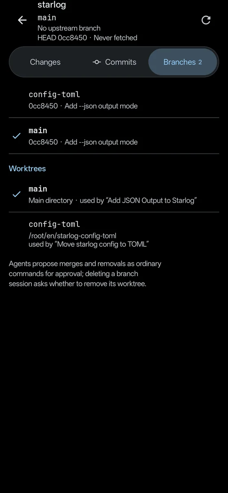

<p align="center">
  <picture>
    <source media="(prefers-color-scheme: dark)" srcset="assets/branding/infinity-dots-dark.svg">
    
  </picture>
</p>

<h1 align="center">Infinity Workbench</h1>

<p align="center">
  An open-source, bring-your-own-key AI workbench for Android.<br>
  A real Linux, a desktop-class agent workbench and SSH server ops in your pocket, built to make the most of a foldable.
</p>

<p align="center">
  <b>English</b> · <a href="README.zh-CN.md">简体中文</a>
</p>

<p align="center">
  
  
  
  
  
</p>

https://github.com/user-attachments/assets/97ec8287-b32f-452f-8bcd-1bffa4f789e6

<p align="center">
  
</p>

## A real Linux in your pocket

The sideload build installs Alpine Linux in one tap: proot, no root, no Termux. `apk add` works, and so do git, Python and anything else your project needs. Agents run their commands in the same system you open in the terminal, with the same paths.

<table>
  <tr>
    <td width="66%"></td>
    <td width="34%"></td>
  </tr>
</table>

## A desktop-class agent workbench

Ask for a change and the agent works the way you would at a desk: it writes a plan, sends read-only sub-agents to survey the code and the tests in parallel, implements, runs the slow test suite as a background job and commits when the suite is green. Side work can become a branch chat in its own git worktree, and the Git panel shows which chat uses which worktree.

<table>
  <tr>
    <td width="50%"></td>
    <td width="50%"></td>
  </tr>
  <tr>
    <td align="center">Sub-agents survey the code in parallel</td>
    <td align="center">Slow commands run as background jobs</td>
  </tr>
  <tr>
    <td width="50%"></td>
    <td width="50%"></td>
  </tr>
  <tr>
    <td align="center">Side work becomes a branch chat in its own worktree</td>
    <td align="center">Branches and worktrees, mapped to chats</td>
  </tr>
</table>

## Server ops over SSH, with you in control

Save a host once and let the agent investigate: it reads unit status and logs, finds the root cause, backs up what it changes, applies the fix and verifies it end to end. The agent sees host aliases only, never passwords or keys, and every remote command waits for your approval. You can take over in a real SSH terminal at any point.

<table>
  <tr>
    <td width="50%"></td>
    <td width="50%"></td>
  </tr>
  <tr>
    <td align="center">Every remote command waits for you</td>
    <td align="center">Root cause, fix and verification in one report</td>
  </tr>
</table>

## Built for foldables

Unfold and the chat shares the screen with an inspector for tasks, files, Git, artifacts and remote terminals, so you can review the agent's work while it talks. Fold the phone and the same chat continues on the cover screen in a single-pane layout.

<table>
  <tr>
    <td colspan="3"></td>
  </tr>
  <tr>
    <td width="33%"></td>
    <td width="33%"></td>
    <td width="33%"></td>
  </tr>
</table>

## Also included

- **Your models, your keys.** OpenAI (Chat Completions and Responses), Anthropic, Google Gemini, Vertex AI, DeepSeek, GLM, Kimi and any OpenAI-compatible endpoint, with streaming, image input and per-chat model switching. Up to four chats can generate at the same time.
- **You decide what runs.** Each chat has its own approval policy, and commands appear as cards you approve or reject before anything executes.
- **Canvas.** Agents build interactive HTML pages with live preview and version history, saved in the chat's workspace.
- **Library with RAG and a knowledge graph.** Import TXT, Markdown, PDF, Word and HTML, with hybrid vector and full-text retrieval, reranking and citations.
- **Secret input and output.** Passwords and tokens go straight to their destination through dedicated cards, never through the chat, logs or the model.
- **Runs in the background and on a schedule.** Generation continues when you leave the app, and agents can schedule one-off, interval or cron jobs with your approval.
- **Rich output.** Markdown, LaTeX, Mermaid, ECharts and content-sized tables.
- **Private by default.** Keys live in Android Keystore. Chats, documents and settings stay on the device, and model calls go straight to the provider you configured. Termux and a built-in Tailscale node are available when you need them.

## Get started

**Requirements:** Android 12 (API 31) or later. The built-in Linux needs the sideload build on an arm64-v8a device, about 64 MB for the base system and about 200 MB with git and Python.

**Builds:** `sideload` includes the built-in Linux and device file access; `play` leaves both out. Both use the package name `com.promenar.infinity`, so they install alongside the old Nexara app.

**Install:** Download the APK and its `.sha256` file from [GitHub Releases](https://github.com/Promenar/Infinity-Workbench/releases), check the SHA-256 and install it. Public releases can lag behind the source tree. Do not install CI artifacts, debug APKs or repackaged builds from other sources.

The source tree is at `v0.14.0-beta` (versionCode `42`). See the [changelog](CHANGELOG.md) for what changed.

## Build from source

You need JDK 17 or newer, the Android SDK, `python3.14` on `PATH` (it precompiles the bundled Python) and Go 1.21 or newer (it builds the Tailscale library).

```bash
cd native-ui
./gradlew :app:assembleSideloadDebug :app:assemblePlayDebug
./gradlew :app:testSideloadDebugUnitTest :app:lintSideloadDebug
```

Debug APKs are written to `native-ui/app/build/outputs/apk/<flavor>/debug/`. Offline builds, signing and release checks are covered in [Development and release verification](docs/guide/development.md) and [Distribution builds](docs/distribution-builds.md).

## Documentation

The detailed guides are written in Chinese.

| Guide | Covers |
|---|---|
| [Features](docs/guide/features.md) | Chat and rendering, context management, RAG, agent tools, sub-agents, browser, background and scheduled tasks, export and backup |
| [Security and privacy](docs/guide/security-privacy.md) | Key storage, backup encryption, SSH, Git and Tailscale credentials, network security, diagnostics |
| [Execution environments](docs/guide/execution-environments.md) | Built-in Linux, Termux, sandboxed script runtimes, SSH |
| [Workspaces](docs/guide/workspaces.md) | Workspace types, Git, what agents can reach, mounted folders |
| [Install and upgrade](docs/guide/install-and-upgrade.md) | Requirements, data migration, APK verification |
| [Development](docs/guide/development.md) | Build commands, bundled Python and Tailscale, rich-content security, icons, tech stack |

See also the [architecture overview](docs/ARCHITECTURE.md) and the [guide index](docs/guide/README.md).

## License

Infinity Workbench is released under the [GNU General Public License v3.0](LICENSE). The settings list, navigation bar and appearance page include Compose adaptations of [Bettbox](https://github.com/appshubcc/Bettbox), also GPLv3. Agent avatar symbols come from Google's Material Symbols Rounded (Apache-2.0). Sources and scope are listed in the [third-party notices](docs/legal/THIRD_PARTY_NOTICES.md).
