<p align="center">
  <picture>
    <source media="(prefers-color-scheme: dark)" srcset="assets/branding/infinity-dots-dark.svg">
    
  </picture>
</p>

<h1 align="center">Infinity Workbench</h1>

<p align="center">
  开源、自带密钥（BYOK）的 Android AI 工作台。<br>
  口袋里的真 Linux、桌面级 Agent 开发环境与 SSH 运维，释放折叠屏手机的真实生产力。
</p>

<p align="center">
  <a href="README.md">English</a> · <b>简体中文</b>
</p>

<p align="center">
  
  
  
  
  
</p>

https://github.com/user-attachments/assets/c48800d9-34a5-4397-97f3-04e7ac21449d

<p align="center">
  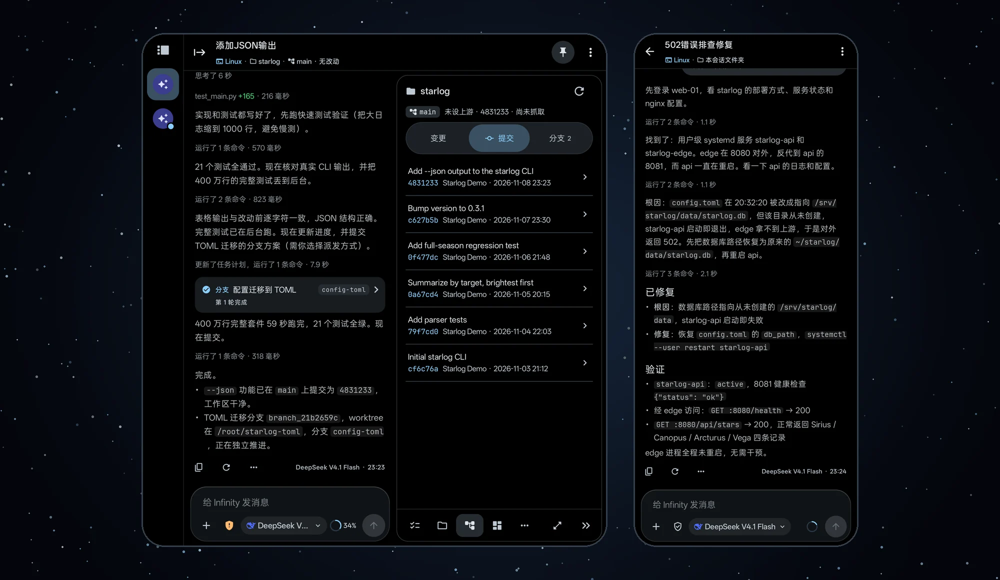
</p>

## 口袋里的真 Linux

侧载版一键安装 Alpine Linux：proot 运行，无需 root，也不依赖 Termux。可以 `apk add` 安装软件，git、Python、Node.js、FFmpeg 和项目需要的工具都能用。Agent 执行命令的环境就是你在终端里打开的同一套系统，路径完全一致。

<table>
  <tr>
    <td width="66%">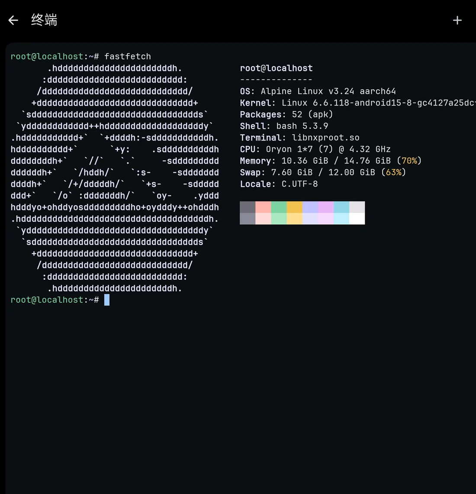</td>
    <td width="34%">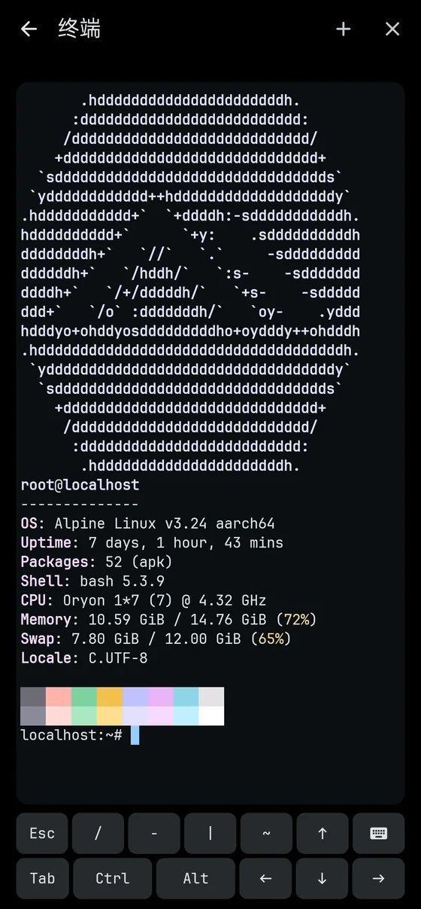</td>
  </tr>
</table>

## 桌面级 Agent 开发环境

提一个改动需求，Agent 会像你坐在电脑前那样推进：先列计划，派只读子代理并行梳理代码和测试缺口，再动手实现；慢的完整测试放到后台任务跑，全绿后提交。顺带的工作可以提成分支会话，在独立的 git worktree 里进行；Git 面板标明每个 worktree 由哪个会话使用。

<table>
  <tr>
    <td width="50%">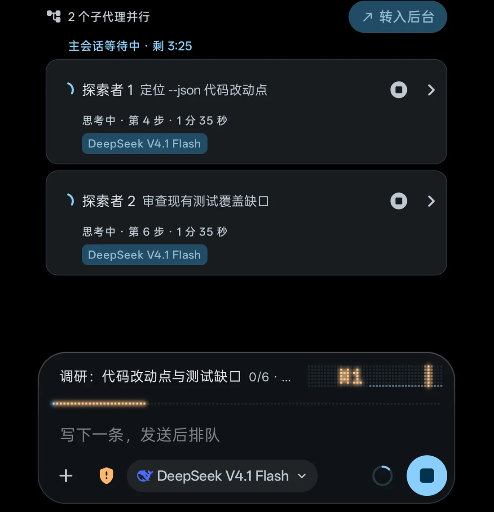</td>
    <td width="50%">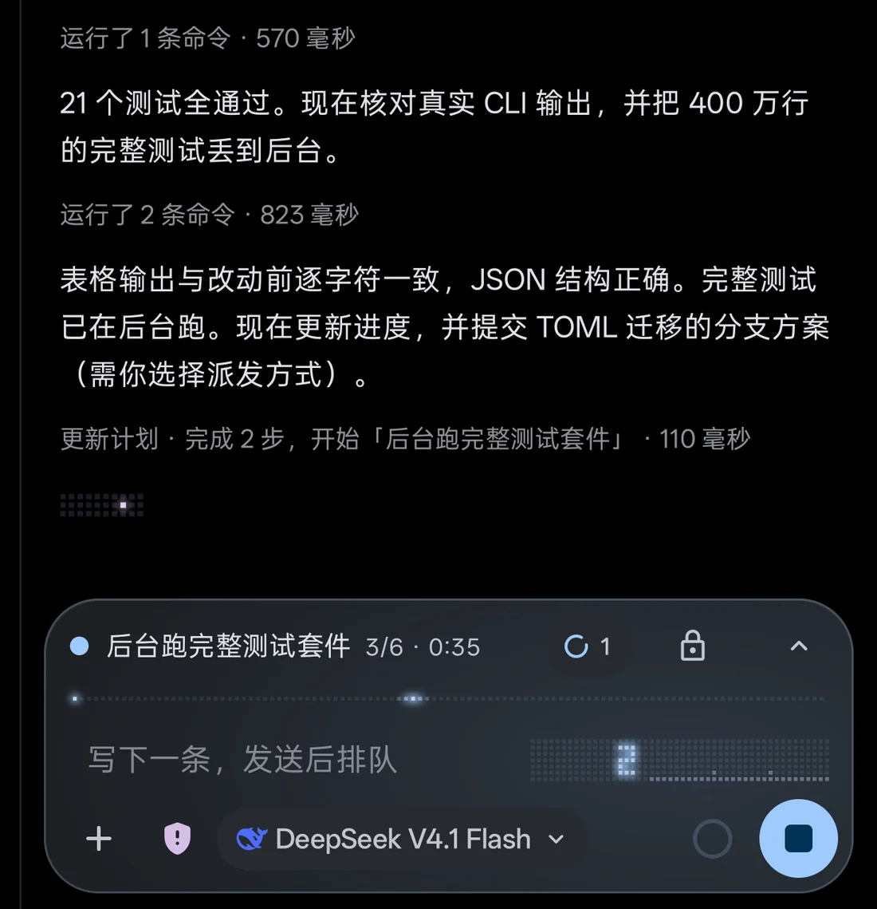</td>
  </tr>
  <tr>
    <td align="center">子代理并行梳理代码</td>
    <td align="center">慢命令转为后台任务</td>
  </tr>
  <tr>
    <td width="50%">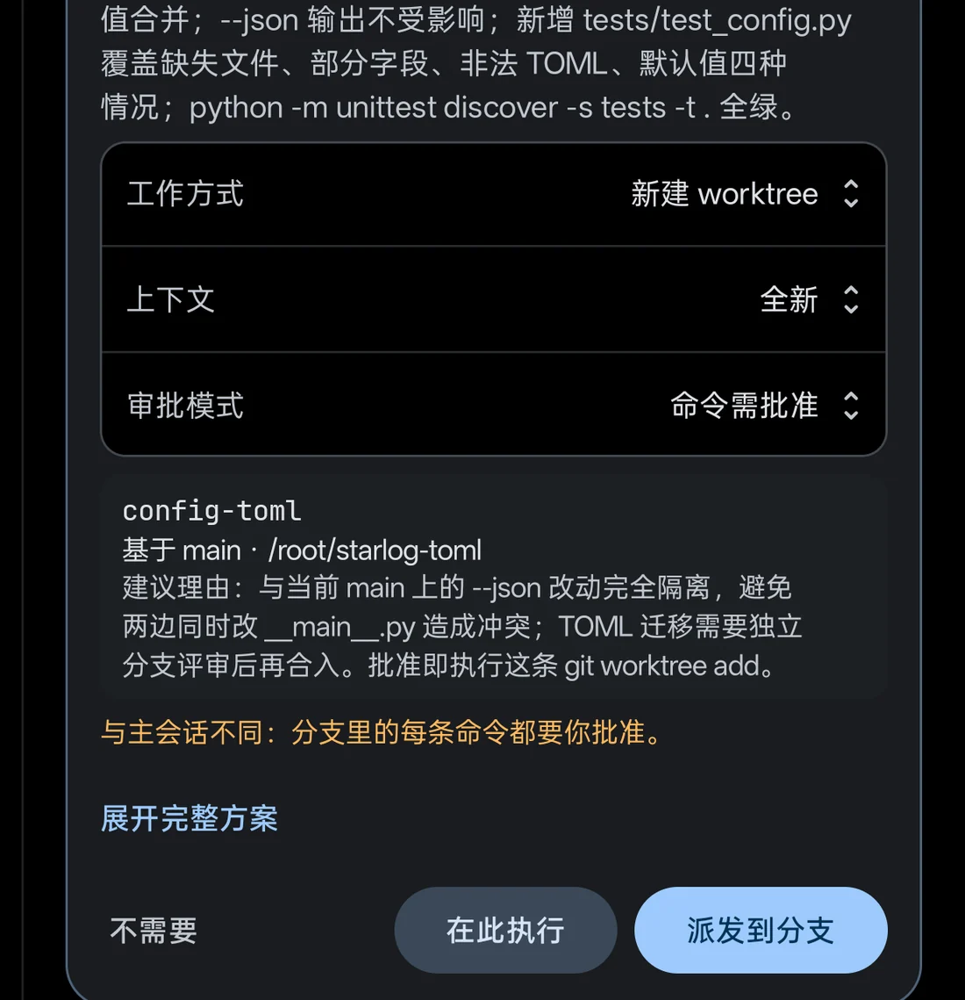</td>
    <td width="50%">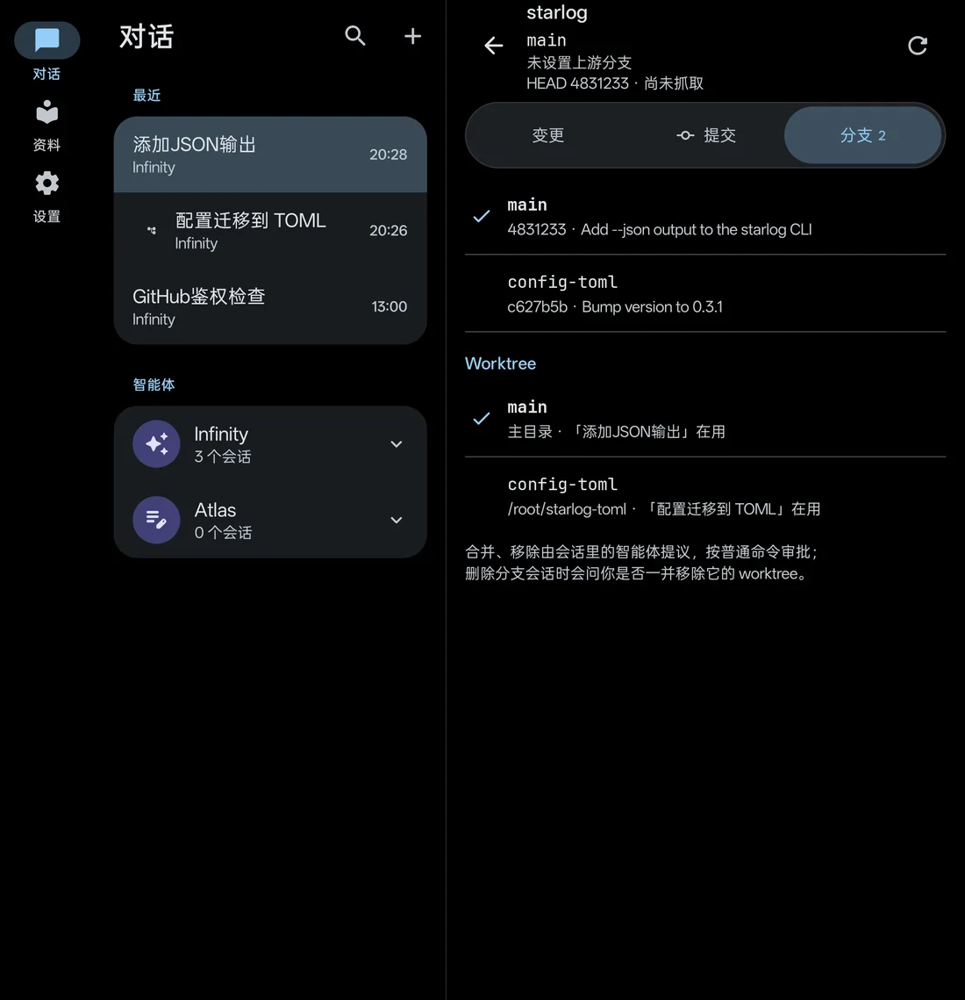</td>
  </tr>
  <tr>
    <td align="center">顺带工作提成分支会话，独立 worktree</td>
    <td align="center">分支与 worktree 对应到会话</td>
  </tr>
</table>

## 让 Agent 替你 SSH 运维

保存一次主机，就可以把排障交给 Agent：它查看服务状态和日志，定位根因，先备份再修改，修复后做端到端验证。Agent 只能看到主机别名，看不到密码和密钥；每条远程命令都要等你批准。你也可以随时打开真实的 SSH 终端亲自接手。

<table>
  <tr>
    <td width="50%">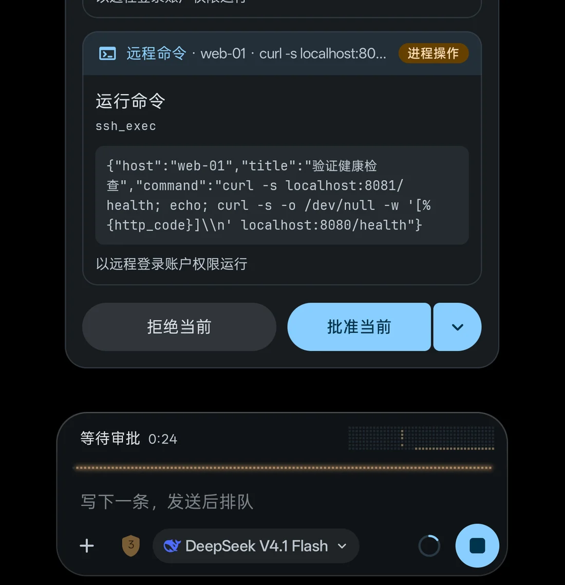</td>
    <td width="50%">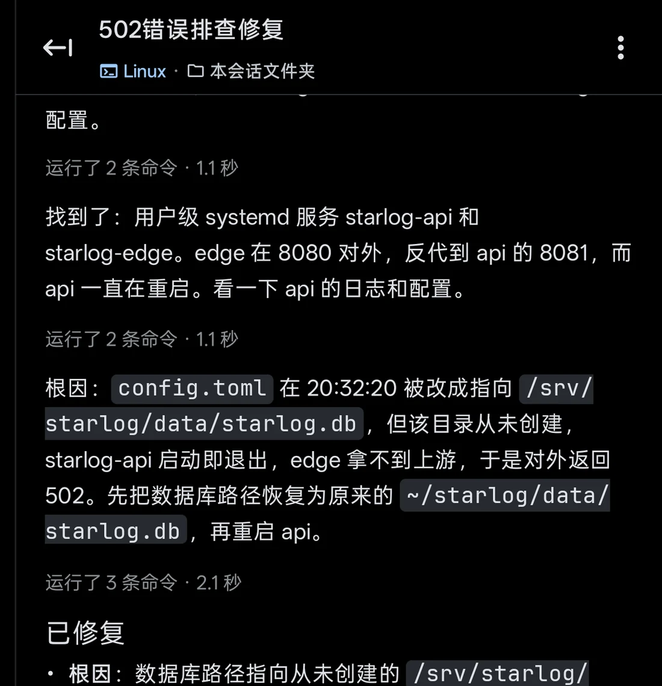</td>
  </tr>
  <tr>
    <td align="center">每条远程命令由你批准</td>
    <td align="center">根因、修复与验证写进一份报告</td>
  </tr>
</table>

## 为折叠屏打造

展开时，会话与检查器并排显示，任务、文件、Git、产物和远程终端都能在旁边打开，Agent 一边汇报你一边核对。合上手机，同一个会话在外屏以单栏布局继续。

<table>
  <tr>
    <td colspan="3">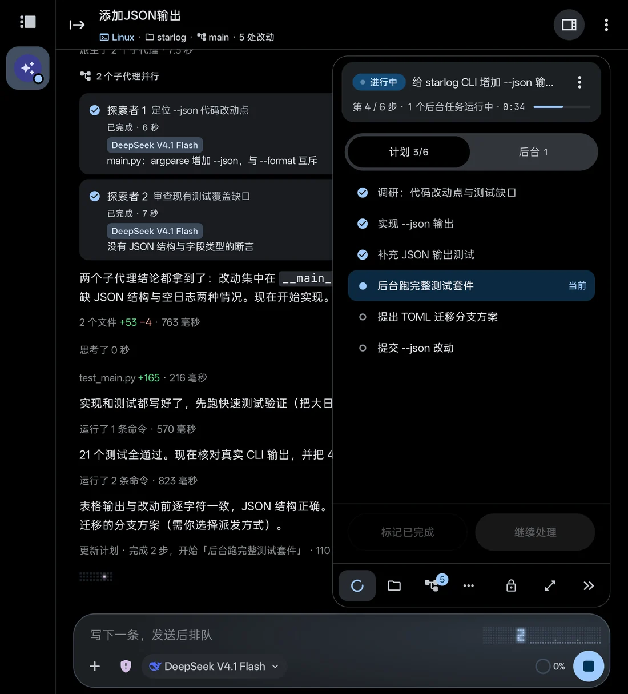</td>
  </tr>
  <tr>
    <td width="33%">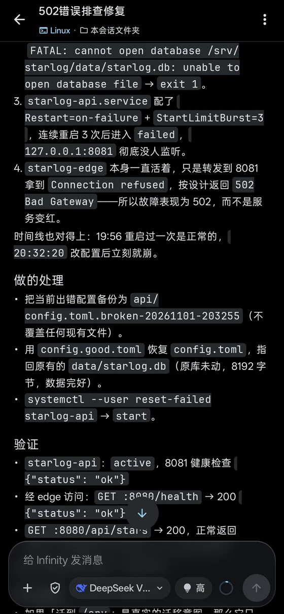</td>
    <td width="33%"></td>
    <td width="33%"></td>
  </tr>
</table>

## 更多能力

- **自选模型，自带密钥**：支持 OpenAI（Chat Completions 与 Responses）、Anthropic、Google Gemini、Vertex AI、DeepSeek、GLM、Kimi 及任意 OpenAI 兼容接口，流式输出、图片输入，会话内可切换模型；最多 4 个会话同时生成。
- **执行由你批准**：每个会话单独设置审批策略，命令先以卡片呈现，批准后才执行。
- **智能体管理智能体**：Agent 可以读取并调整智能体与会话的配置，例如新建一个翻译助手、改写提示词；每次写入都需你批准，审批卡列出字段变化与提示词差异。提示词保留最近 20 个历史版本，可随时恢复。
- **画布**：Agent 生成可交互的 HTML 页面，支持实时预览与版本记录，保存在会话工作区。
- **资料库：RAG 与知识图谱**：导入 TXT、Markdown、PDF、Word、HTML，向量与全文混合检索、重排和引用追踪。
- **保密输入与输出**：密码和令牌经专用卡片直达去向，不进入对话、日志与模型上下文。
- **后台与定时**：切到后台仍继续生成；Agent 可创建单次、间隔或 cron 定时任务，每项都需你批准。
- **富内容**：Markdown、LaTeX、Mermaid、ECharts，表格按内容排版。
- **默认保护隐私**：密钥由 Android Keystore 保护；会话、文档和配置保存在本机，模型请求直连你配置的服务商。需要时还可接入 Termux 与内置 Tailscale 节点。

## 开始使用

**运行要求**：Android 12（API 31）及以上。内置 Linux 需要侧载版和 arm64-v8a 设备，基础系统约占 64 MB，默认加装 git、ripgrep、Python、Node.js 与 FFmpeg 共约 470 MB，可按需取消。

**两个渠道**：`sideload` 包含内置 Linux 与设备文件访问，`play` 不含这两项。两者包名均为 `com.promenar.infinity`，可与旧版 Nexara 并存。

**安装**：从 [GitHub Releases](https://github.com/Promenar/Infinity-Workbench/releases) 下载 APK 与对应 `.sha256` 文件，核对 SHA-256 后安装。公开发布可能落后于源码；不要安装 CI 临时制品、Debug APK 或来源不明的重打包版本。

当前源码版本为 `v0.17.0-beta`（versionCode `48`），变更见[更新日志](CHANGELOG.md)。

## 从源码构建

需要 JDK 17 及以上、Android SDK、`PATH` 中的 `python3.14`（预编译打包 Python）和 Go 1.21 及以上（编译 Tailscale 库）。

```bash
cd native-ui
./gradlew :app:assembleSideloadDebug :app:assemblePlayDebug
./gradlew :app:testSideloadDebugUnitTest :app:lintSideloadDebug
```

Debug APK 输出在 `native-ui/app/build/outputs/apk/<渠道>/debug/`。离线构建、签名与发行检查见[开发构建与发行验证](docs/guide/development.md)和[发行渠道构建](docs/distribution-builds.md)。

## 文档

| 文档 | 内容 |
|---|---|
| [功能详解](docs/guide/features.md) | 对话与渲染、上下文管理、RAG、Agent 工具、子代理、浏览器、后台与定时任务、导出与备份 |
| [密钥与隐私](docs/guide/security-privacy.md) | 密钥存储、备份加密、SSH/Git/Tailscale 凭据、网络安全、诊断事件 |
| [执行环境](docs/guide/execution-environments.md) | 内置 Linux、Termux、隔离脚本运行时、SSH |
| [工作区与外部文件夹](docs/guide/workspaces.md) | 工作区类型、Git、Agent 可达范围、文件夹挂载 |
| [安装、升级与数据迁移](docs/guide/install-and-upgrade.md) | 运行要求、数据迁移、APK 验真 |
| [开发构建与发行验证](docs/guide/development.md) | 构建命令、打包 Python 与 Tailscale、富内容安全策略、图标、技术栈 |

另见[架构说明](docs/ARCHITECTURE.md)与[使用指南索引](docs/guide/README.md)。

## 许可证

Infinity Workbench 以 [GNU General Public License v3.0](LICENSE) 发布。设置列表、底部导航与外观页包含对同为 GPLv3 的 [Bettbox](https://github.com/appshubcc/Bettbox) 视觉实现的 Compose 转译；智能体头像符号来自 Google Material Symbols Rounded（Apache-2.0）。来源与范围见[第三方通知](docs/legal/THIRD_PARTY_NOTICES.md)。
