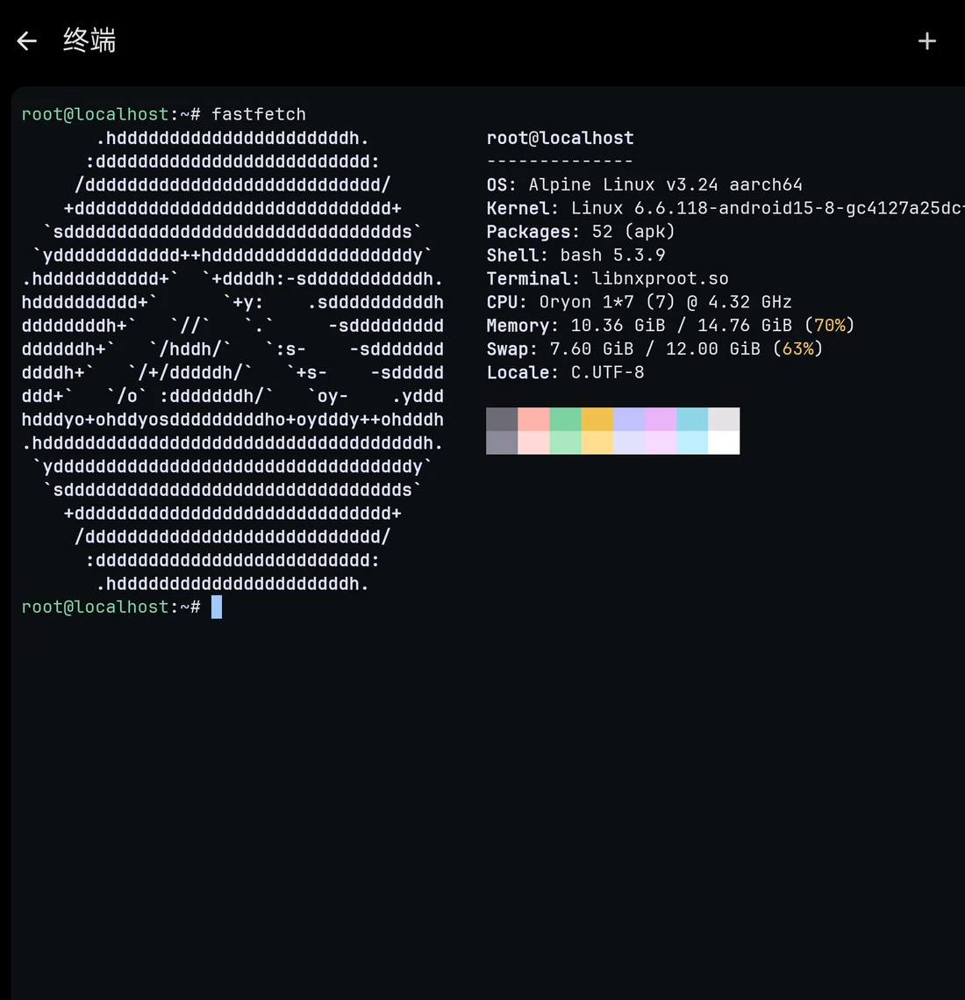
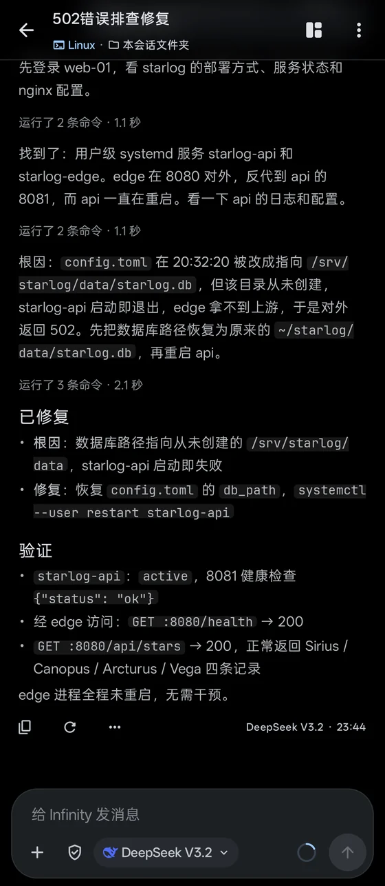
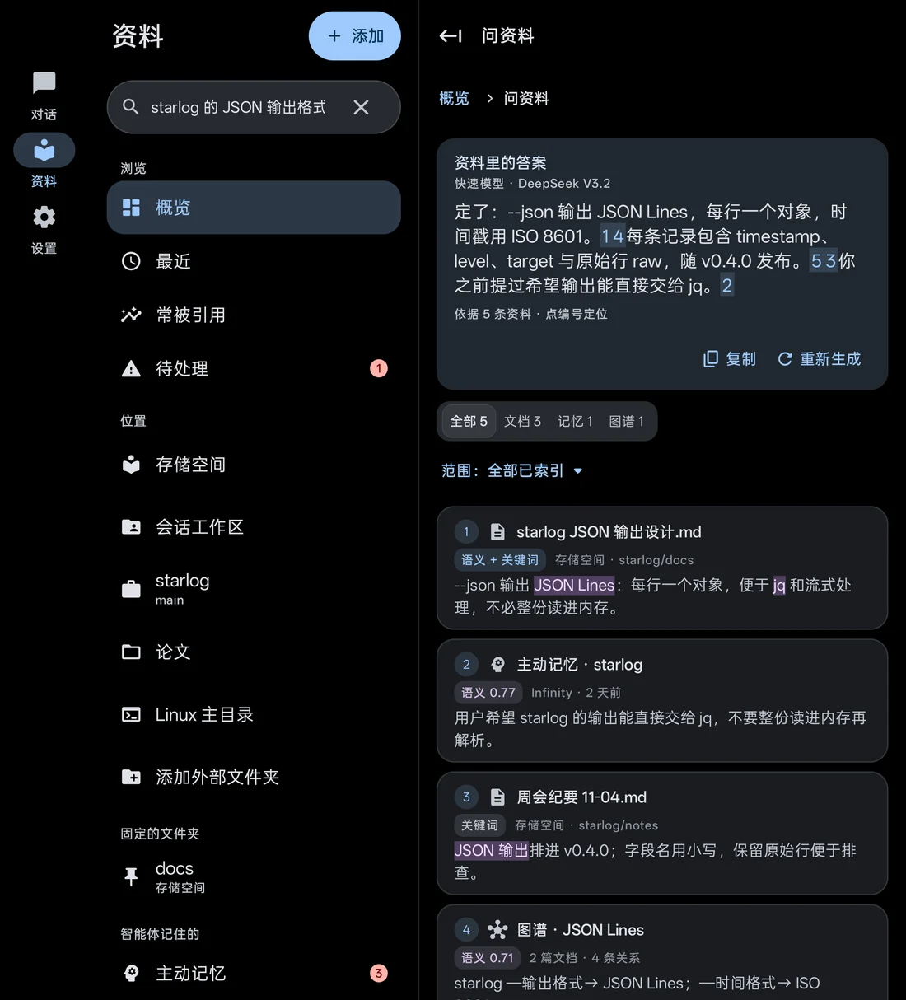
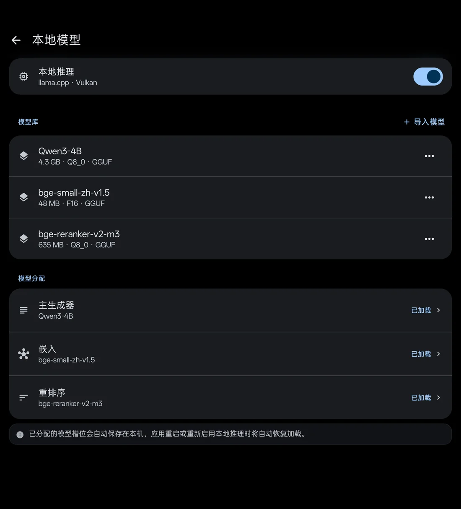
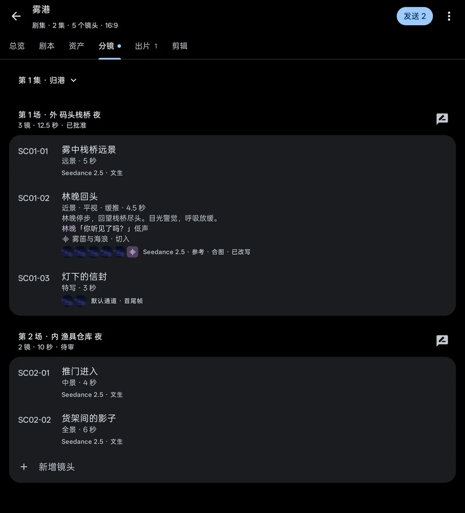

<p align="center">
  
</p>

<h1 align="center">Infinity Deck</h1>

<p align="center">
  <b>运行在 Android 上的开源本地优先 AI 智能体工作台。</b><br>
  集成 Alpine Linux 容器、Git、SSH、嵌入式 Tailscale、端侧语音与 GGUF 推理、混合 RAG 知识库及多媒体制作流水线。<br>
  自带 API Key 或本地模型运行，数据与凭据保存在本机。
</p>

<p align="center">
  <a href="README.md">English</a> · <b>简体中文</b>
</p>

<p align="center">
  <a href="https://github.com/Promenar/Infinity-Deck/releases"></a>
  <a href="https://infinityware.work"></a>
  
  
</p>

**Infinity Deck** 是一个面向 Android 12+ 的开源 AI 工作台，将多智能体编排、本机代码与命令执行环境、私有网络接入、离线语音转写、文档知识库与音视频生成工具整合在单应用中：

- **本地执行层**：内置免 Root 的 Alpine Linux（`arm64-v8a`，配全运行时 `proot` 硬件资源治理）与单 APK 16KB 页对齐 **10 项原生工具加速链**（`git`、`rg`、`fd`、`jq`、`sqlite3`、`zstd`、`bsdtar`、`rsync`、`ffmpeg`、`ffprobe`），经应用私有 Unix socket 转发桥透明绕过 `proot` 性能损耗，并搭配内置 Python 3.14、QuickJS 与一等 `git_exec` 工具，在设备端高效完成脚本、代码仓库与音视频处理，不依赖远程电脑在线。
- **模型与端侧推理**：支持通过自有 API Key 接入主流大模型服务商、双区预设（MiniMax / Token Plan 与智谱 / Coding Plan 中性中国/国际变体）及 Google AI Studio **Gemini TTS**（30 种预置音色）与 **Lyria 3 / 3.5** 音乐生成；内置基于 `llama.cpp` 的 GGUF 本地推理引擎（支持主对话、Embedding、Rerank 三槽位、`16K / 8K / 4K` Prefix KV Cache 与默认关闭的「启动时自动加载模型」开关，冷启常驻内存更低）及 `sherpa-onnx` 离线语音管线（X-ASR 流式转写、SenseVoice 二遍校准、说话人分段与声纹识别），并支持纯聊天/智能体系统提示词分层瘦身与时间线锚定检查点压缩。
- **私有网络、内置代理与远程运维**：内置用户态 Tailscale 节点（兼容自建 Headscale）与独立用户态多协议内置代理（`libnxproxy.so`，免系统 VPN、关闭零常驻内存）共存互补——Tailnet / 局域网与 Tailscale P2P 始终原生直连，同时支持 AI 提供商按需勾选代理，内置浏览器、Agent 公网工具与公网 Git / GitHub HTTPS 自动生效，并在 Alpine Linux 内按需注入 `$INFINITY_PROXY_*`。
- **知识库与创作工作台**：资料库「文件」四分类与一步确认工作区管理、外部目录 `read_only / read_write` 分级挂载、文档切片检索与实体知识图谱带编号引用溯源、离线录音富格式整理（表格 / Mermaid / ECharts / LaTeX 与长图 PNG/PDF 导出）、可交互多屏网页画布、全入口应用内直连音频播放与助手气泡「朗读」、零硬编码 ComfyUI 全能提交器框架（14 个 `comfy_*` 工具），以及常驻开放、支持工作区自动扫描挂载、逐工作流参考入参模式、云端 Lyria 配乐与离线 `Three.js` 3D 白模预演的制作面板。

## 目录

- 🧭 [架构与运行特性](#架构与运行特性)
- ✨ [核心工作流](#核心工作流)
- 🔒 [安全与数据边界](#安全与数据边界)
- 🚀 [安装与构建](#安装与构建)
- 🧰 [功能清单](#功能清单)
- 💬 [常见问题](#常见问题)
- 📚 [技术文档](#技术文档)
- 🤝 [参与贡献](#参与贡献)

## 架构与运行特性

- **设备端独立运行**：命令执行、Git 仓库操作、文档解析与端侧推理均在手机本地完成；需要重算力时可通过 SSH 或 Tailscale 调用远端工作站与 GPU 主机。
- **多协议模型路由**：原生适配 OpenAI Responses / Chat Completions、Anthropic Messages、Google Gemini / Vertex AI 等协议，支持会话中途切换模型与单模型连通性测速。
- **无公网暴露内网直连**：内置 Tailscale 节点将应用内网络请求直接路由至私有 `tailnet`，无需配置公网端口映射或启用系统级 VPN。
- **人工回路（Human-in-the-loop）控制**：工具调用支持计划确认、逐条命令审批、结构化提问卡、后台任务队列与消息插队。
- **移动与大屏自适应布局**：支持单手审批、后台保活、防误触口袋锁与全站 **厚玻璃光效浸润**；在折叠屏与平板上提供三列布局与精简后的可固定/加宽熏黑右侧检视器（常驻「任务 / 文件 / Git / 浏览器」，按需显示「产物 / 状态 / 制作」，支持大页签左右滑动切页），合盖外屏平滑收敛为 93% 熏黑毛玻璃上滑抽屉并保持会话与任务上下文连续。

## 核心工作流

<p align="center">
  
</p>

<table>
  <tr>
    <td width="50%" valign="top">
      
      <h3>计划拆解与并行子代理</h3>
      智能体在执行复杂任务前先生成步骤清单，并可并行派生多个只读或专项子代理（单会话最多 32 个并行，单批最多 8 个）分别执行代码检索、资料核对或测试审查，执行结果与耗时自动聚合回主会话。
    </td>
    <td width="50%" valign="top">
      
      <h3>Git Worktree 与分支会话隔离</h3>
      可将独立子任务派生为分支会话，并绑定单独的 Git Worktree 目录。主会话与分支会话在各自的工作树中并行修改代码与运行测试，通过内置 Git 检视器统一查看分支、Diff 与提交历史。
    </td>
  </tr>
  <tr>
    <td width="50%" valign="top">
      
      <h3>SSH 远程执行与逐条命令审批</h3>
      通过 SSH 连接远程主机排查服务异常。默认审批模式下，每一次远程命令调用均会展示目标主机、命令原文与权限说明，经人工确认后方可执行，并在完成后输出结构化排障记录。
    </td>
    <td width="50%" valign="top">
      
      <h3>内置免 Root Alpine Linux</h3>
      应用内一键部署 `arm64-v8a` Alpine Linux 用户态环境，无需设备 Root 或外部 Termux。高频工具（`git`、`rg`、`fd`、`jq`、`sqlite3`、`zstd`、`bsdtar`、`rsync`、`ffmpeg`）经宿主原生转发桥透明加速并受全运行时硬件资源治理护航，亦可通过 `apk add` 按需扩展。
    </td>
  </tr>
  <tr>
    <td width="50%" valign="top">
      
      <h3>折叠屏三列工作台与检视器</h3>
      大屏与折叠屏内屏采用「导航 · 40dp 极简分支窄栏 / 会话列表 · 主会话」自适应结构。右侧检视器采用统一黑曜石熏黑毛玻璃与底缘横滑短标题轨道，集中承载任务进度、文件树、Git、内置浏览器及按需展示的产物/状态/制作面板，支持固定分栏与加宽覆盖抽屉。
    </td>
    <td width="50%" valign="top">
      <p align="center"></p>
      <h3>开合屏状态无缝接续</h3>
      合上折叠屏后，当前活动会话自动迁移至外屏并保持滚动位置与输入状态，便于单手审阅输出、点击命令或锁审批卡片，以及从顶部悬浮通知胶囊快速处理状态提示。
    </td>
  </tr>
  <tr>
    <td width="50%" valign="top">
      
      <h3>端侧离线语音与录音整理</h3>
      内置离线流式听写（X-ASR）、可选 `SenseVoice-Small int8` 二遍精修（按设备内存与 CPU 自动分级，含 RTF 熔断退避）及本地说话人分离（pyannote + CAM++）。支持录制中生成整理草稿、富格式图表与公式整理稿、双栏「编辑 / 预览」、双向 CAS 同步 `/mnt/knowledge` 与 `1440px+` 单张 PNG/PDF 导出。
    </td>
    <td width="50%" valign="top">
      
      <h3>混合 RAG 资料库与知识图谱</h3>
      支持导入 PDF、Word、Markdown、HTML 或以 `read_only / read_write` 分级挂载目录，融合文档向量、关键词检索、跨会话长期记忆与实体知识图谱生成带编号引用的答案，一键定位高亮原文。
    </td>
  </tr>
  <tr>
    <td width="50%" valign="top">
      
      <h3>模型路由与端侧 GGUF 推理</h3>
      支持自有 API Key 接入主流云端模型与 Coding Plan 预设，内置 `llama.cpp` 引擎独立托管对话（Main）、向量嵌入（Embedding）与重排序（Rerank）三槽位并支持重启自动恢复，配合内置 Tailscale 直连私有模型网关。
    </td>
    <td width="50%" valign="top">
      
      <h3>画布原型、3D 白模预演与音视频制作面板</h3>
      支持生成可交互多屏网页原型、画板蒙版重绘与多图滑切查看器（1×–5× / 90° 旋转）；通过制作面板管理剧本、双模视觉参考资产、已锁定项 AI 改写审批、离线 `three.js` 3D 白模分镜预演（Beauty/Depth 抽帧与硬件 MP4 导出）及多通道生视频（Seedance、MiniMax、ComfyUI）粗剪合成。
    </td>
  </tr>
</table>

## 安全与数据边界

- **按风险分级审批与根目录硬拦截**：默认「按风险审批」档对经严格词法解析的零副作用只读命令自动免批，写/执行命令、文件删除与工作区外写入需确认；「免批准」档跳过常规 L1 动作，而技能、智能体配置、ComfyUI/SSH/定时任务等 L2 运行时管理在两档均始终逐次确认。针对系统根 `/`、共享存储根 `/sdcard`·`/storage/emulated/0`、应用数据根或未展开根目录变量的毁灭性命令在两档下均直接硬拦截，不弹审批卡。
- **凭据上下文隔离**：密码与令牌输入通过独立保密输入卡直接写入加密凭据库，不进入 LLM 上下文与聊天记录，显示期间启用 `FLAG_SECURE` 禁止截屏。
- **Android Keystore 钥匙串**：API Key、SSH 私钥、Git 令牌与站点凭据均加密存储；查看明文需通过系统生物识别或锁屏认证，展示 30 秒后自动隐藏，复制后 60 秒自动清理剪贴板。
- **本地存储与直连请求**：会话数据库、知识库索引、录音与配置均存储在设备本地；模型调用从客户端直接发往所配置的接口地址，无中间代理服务器。
- **加密备份导出**：支持导出本地加密备份包（含可选声纹与凭据恢复机制）或同步至 WebDAV。
- **开源许可**：采用 GPL-3.0 许可证开源。

## 安装与构建

### 安装预编译包

1. 从 [GitHub Releases](https://github.com/Promenar/Infinity-Deck/releases/latest) 或 [官方网站下载页](https://infinityware.work/download/) 下载签名 `.apk` 与同名 `.sha256` 校验文件。
2. 校验 SHA-256 摘要一致后安装（仅安装官方 Releases 签名包，勿使用 CI 临时构建产物或第三方重打包文件）。
3. 启动应用，在设置中配置云端模型 API Key，或按需下载内置 Linux、离线语音模型与本地 GGUF 模型。

- **运行要求**：Android 12（API 31）及以上。内置 Linux、端侧 GGUF 推理需 `arm64-v8a` 设备；Alpine 基础环境约 64 MB，含默认工具链（git、ripgrep、Python、Node.js、FFmpeg）约 470 MB，安装时可按需取消勾选。
- **应用更新**：通过「设置 › 关于 › 检查更新」查询 GitHub 最新 Release 并跳转下载，应用不会在后台自动下载或静默安装 APK。
- **当前版本**：`v0.81.3-beta`（versionCode `244`）。近期重点交付：**全站公网通道内置代理全覆盖与线上模型规格库更新根治**（修复 `PublishedModelCatalog` 未兼容线上 schema v3 目录旧版 `"workload": "AUDIO"` 导致拉取验签后解析抛错的问题，按模型 ID 精确细分映射为 `REALTIME`/`MUSIC`/`SPEECH` 并补充脱敏告警日志；新增带严格 407 `CONNECT`/realm/地址校验与 `X-Infinity-Public-Target: 1` 的按需内置代理原语 `applyOptionalBuiltInProxy`，严格保留本机、局域网私网与 Tailscale 直连分流；修复模型规格库在线更新绕过内置代理并在代理就绪/重启后自动补刷；同步将技能商店、公网网页搜索、公网远程 MCP、GitHub Releases 更新检查、本地 GGUF 与离线语音识别模型下载、MiniMax 云端音频下载、富内容 WebView HTTPS 资源抓取、云端 WebDAV 备份及公网 ComfyUI 端点全部接入内置代理）；**Google Gemini / Vertex AI 原生生图直通、审批面板全面内联化与视频生产全链路真机审计闭环**（`generate_image` 自动路由 Google Gemini / Vertex AI 默认生图模型（如 Nano Banana）至原生 `:generateContent` 图像生成与多图编辑，不再报 `PROTOCOL_UNSUPPORTED`；解除 `upsert_shot(spec_width, spec_height)` 整数校验冲突，对所有声明 `WIDTH`/`HEIGHT` 自由像素槽位的 ComfyUI 工作流统一放行 `64..4096` 范围内 32 对齐自定义宽高并透出真实规划错误，补齐 `add_asset_version(duration_seconds)` 声音时长落库、`DERIVE`/`POST_PROCESS` 通道隔离、`comfy_run_workflow(asset_id)` 资产进度与版本自动登记、总览准确计数提示、用户手改 Prompt 告警、Tier-2 候选快照、中文化文案、WAV 首尾静音裁剪、24fps CFR 粗剪标题卡及产物面板自动排除已绑定制作项目目录；彻底去除全屏审批大弹窗，全面切换方向 C 风格「一行快捷批准 + 原地平滑展开」内联审批槽；同步升级总览「全剧进度」置顶与待审/已处理计数拆分、检视器统一「制作」与双角标、6+ 页签右缘渐隐、剧本/出片多集下拉筛选、后处理默认选中派生候选与一键「原片 / 后处理」A/B 切换、窄栏双行满宽进度条播放器、分镜真实参考总数、声音卡片时长与角色绑定徽标、`440dp` 宽屏限宽单选弹层、灯箱高对比分页胶囊及溢出 Markdown 表格横向渐隐）；**分镜精写 Prompt 保留、通用 ComfyUI 工作流派生打通与 `shot_ref` 自动登记闭环**（修复 `production_plan`/`production_generate` 覆盖智能体写入的非空 `shot.prompt` 的问题，仅空白或显式重编时编译并保留用户手改只读保护；打通 `production_operations` / `production_derive` 直接发现并执行通过预检的通用 ComfyUI `POST_PROCESS` / 视频输入工作流，共享候选容量预留并同步进度与派生候选登记；`comfy_run_workflow(shot_ref)` 省略 `output_dir` 时默认落盘至 `<项目根>/<集 ID>/takes/`、按实际视频输入精准匹配派生来源，并补全工具说明明确收到 `registered_take_id` 后跳过重复 `add_take`）；**分镜镜头规格面板原位内联与窄检视器分组头防挤压**（移除独立镜头规格模态弹窗，改为在「通道与模式」分组内点击「规格」行平滑展开/收起内联编辑区，本地 ComfyUI 工作流支持「工作流默认 / 自定义」分段切换、无框浅底宽高槽、宽高互换与实时比例提示，云端通道支持动态能力枚举单行即点即选；同时为 `ProductionSectionHeader` 左侧主标题保底 `56%` 宽度、右侧长通道名占余量单行省略，消除窄检视器下节头竖排挤压）；**视频制作管线升级、通用 ComfyUI 兼容桥接、可读变更审批与全站页签/Todo 重构**（统一制作面板、运行详情、远程、Git、产物与引用详情在 `InfinityPanelTabs` 下的顶部间距；移除 Todo 顶部进度条并以圆角分组容器、内缩分割线、首行视觉对齐图标、`3dp` 进行中色条及 3 行点击展开全面优化长短混排列表；新增默认隐藏的「后处理」可选阶段与动态页签并移除总览冗余「声音」项；修复旧 ComfyUI 模板宽高误标 `FIXED` 的问题并补齐不硬编码具体工作流的单镜头分辨率/宽高正常生成参数、通用 `ANCHOR → GUIDES` 透传、只读锁帧与多段链检视，以及 `comfy_run_workflow` 带 `shot_ref` 时自动向总览「任务」队列同步进度与视频派生登记；同时补齐分张参考图去重、锁场参考位免审批边界与中文可读变更审批卡/原子全批）；**外屏 93% 工作表贴底修复、全入口直连音频播放、Lyria 3 / 3.5 解析补齐与语音/音乐工具徽章**（将窄屏/折叠外屏 93% 上滑工作表高度约束下移至内容容器内部，消除贴顶悬浮与底部露出输入框的问题；聊天正文音频链接、产物面板与工作区文件管理器统一支持应用内直连音频播放卡片与播完重播，保留保存/分享/外部打开及窄屏大字双行适配；扩展 Google AI Studio Lyria 3 / 3.5 Interactions API 响应解析覆盖 `steps[]`/嵌套 `outputs[]`/有界递归音频提取与脱敏诊断；工具调用新增独立的「合成语音」与「生成音乐」分类、图标与中英文摘要）；**审批批准即时执行态、连续多文件编辑异向滚动流式行与 ComfyUI 主机设置边距修复**（补齐 ComfyUI 主机设置页签顶部与两侧 `16dp` 标准边距；修复审批卡批准后命令执行完成前浮岛流光、运行坞、宠物停在黄色等待态及发送键呈灰而非停止键的问题；连续多文件编辑移除「正在修改文件…」冗余文案，直接展示生成动画与真实文件名、绿 `+N` 向上 / 红 `−M` 向下异向滚动计数，同批次多文件逐行常驻且同文件原行累加，全部改完平滑折叠为单行变更汇总）；**Google AI Studio 语音（TTS）与音乐（Lyria 3 / 3.5）全链路、语音/音乐/实时类型三分、气泡「朗读」与全站顶部熏黑通知胶囊统一**（将旧「音频」拆分为「语音」「音乐」并新增「实时」独立类型，兼容无损迁移历史设置、补齐 `lyria`/`veo` Google 图标并自动排除出聊天选择器；原生接入 Gemini TTS 30 种预置音色与 `audio/L16` 自动 WAV 封装、Lyria 3 / 3.5 Interactions API 与 `:generateContent` 自动回退及 OpenAI Speech；新增 `generate_speech` 与 `generate_music` 独立内置工具并打通制作面板云端配乐与预置音色配音；助手气泡底部新增「朗读」按钮，仅清洗并朗读回复正文、跳过思考与工具日志、含无正文/未设默认模型硬拦截及缓存互斥播放；全站顶部熏黑悬浮通知胶囊 `InfinityNoticeHost` 移除右侧 `X` 按钮并接管会话页全部提示）；**视频制作面板体验重构、主动装载闭环与媒体能力目录去排序化**（修复总览在无剧本文档时误报「待审」、将项目/全剧进度卡提至总览顶部、根治宽屏检视器打开「媒体模型」时的毛玻璃透底重叠；常驻开放「视频」标签并在空面板提供工作区 `production.json` 自动扫描、一键挂载与一键让智能体建项，升级系统提示词与会话内单次轻提示避免多镜头/动作试验片漏装面板；「媒体模型」移除三组排序箭头及视频/音频组静态默认标、仅标注真实生效的云端默认图像模型并支持直达 ComfyUI 工作流编辑器，将资产参考入参模式与上限收敛至逐工作流/逐模型配置并支持 `fixed_overrides.character_reference_mode` Diff 实验覆写与同项目多模型混排，制作面板右上角 `⋮` 收敛为带安全解绑确认的轻量黑曜石下拉菜单）；**第一批跨平台键鼠交互基础设施、工具调用零抖动交接与流式工具参数速率动效**（全站 `LocalIndication` 悬停高亮、`PointerIcon.Hand` 手型光标与横向标签滚轮滚动，统一「鼠标右键 = 长按」在指针坐标就地弹出菜单，输入框与搜索栏接入 Pre-IME 硬件键处理兼容微信输入法等中文 IME 组词态、支持非组词态 `Enter` 发送 / `Shift+Enter` 换行 / 内联 `Ctrl/Cmd+Enter` 提交与 `Esc` 逐层关闭，全站弹层、页头搜索栏、附件菜单与无焦点子页支持 `Esc` 逐层关闭/返回且不抢终端按键、根页不误退；消除「等待模型响应 / 正在准备工具调用」转入思考/工具行时旧槽位缓退重叠引发的列表上下抽动；流式 `toolCalls` 参数纳入实时 Token 速率估算与单消息用量校准并在首个工具分片即进入 `STREAMING`，避免长工具参数期间点阵屏掉 `0.0` 与波形躺平）；**黑曜石错误诊断卡片、MiniMax / 智谱 Z.AI 双区预设、视频/音频模型类型与重排目录补齐**（全协议透传脱敏 HTTP 状态、错误码与原始负载，明确识别 HTTP 402 与 MiniMax `1008` 等余额不足并停止无效重试，中性「中国 / 国际」四变体预设覆盖 MiniMax / MiniMax Token Plan / 智谱 / 智谱 Coding Plan，「编辑模型」新增视频/音频类型、13 项 Seedance / MiniMax 云端媒体预设与零计费验证，补齐 13 个主流重排模型与 `Pro/`、`Free/` 前缀识别）；**流式首轮零重复准备、内屏侧边栏按会话持久化、全站 `93%` 上滑卡片收口与资源管理器 B 档轻页头**；**时间线锚定压缩分割线、对话全流程防跳变与 `session_read` 分段续读**；单 APK 16KB 页对齐 `arm64-v8a` **原生 10 工具加速链与通用宿主工具转发桥** 及 **`git_exec`**；全运行时 **`proot` 硬件资源治理** 与 **本地模型按需启动**；全站 **厚玻璃光效浸润**；独立用户态 **内置代理**（`libnxproxy.so`）与 Tailscale P2P 共存；零硬编码 **ComfyUI**（14 个 `comfy_*` 工具）与 **L1 / L2** 按命令风险分级审批。详细逐版记录见 [CHANGELOG.md](CHANGELOG.md) 与 [发行页面](https://github.com/Promenar/Infinity-Deck/releases)。

### 从源码构建

需要 JDK 17+、Android SDK（API 36 / Build Tools 36.0.0 / NDK / CMake 3.22.1）、`PATH` 中的 `python3.14`（预编译内置 Python 标准库与依赖字节码）以及 Go 1.21+（编译内置 Tailscale 动态库 `libnxtailnet.so` 与内置代理动态库 `libnxproxy.so`）。

```bash
cd native-ui
./gradlew :app:assembleSideloadDebug
./gradlew :app:testSideloadDebugUnitTest :app:lintSideloadDebug
```

Debug APK 输出路径为 `native-ui/app/build/outputs/apk/sideload/debug/app-sideload-debug.apk`。完整构建说明、离线依赖校验与发行门禁见[开发构建与发行验证](docs/guide/development.md)及[发行渠道构建](docs/distribution-builds.md)。

## 功能清单

**对话与模型层**

- 支持接入 OpenAI、Anthropic、Gemini、Vertex AI、DeepSeek、GLM、Kimi、百炼、OpenRouter、SiliconFlow、xAI 等服务商与任意兼容端点，内置主流 Coding Plan 及中性「中国 / 国际」双区预设（OpenCode Go/Zen、百炼、MiniMax / Token Plan、智谱 / Coding Plan、Kimi、方舟），细分 **语音（TTS）/ 音乐 / 实时 / 视频** 模型类型与零计费验证、补齐 13 款主流重排模型，并提供黑曜石错误诊断卡片（脱敏展示上游错误码与余额不足 `QUOTA` 识别）
- 端侧 GGUF 推理（`llama.cpp`）：支持 `MAIN`（对话与工具调用）、`EMBEDDING`、`RERANK` 三槽位独立管理与可选「启动时自动加载模型」开关（默认关闭以保持低冷启内存）；支持 `Q8_0` KV 缓存量化、跨轮前缀 KV 复用与按可用内存自适应 `16K / 8K / 4K` 上下文；已加载的主槽位模型动态注入会话模型选择器
- 支持会话中途切换模型，最多 16 个会话并发生成；生成期间支持下一条消息排队或插队打断，并支持对已发送用户消息就地编辑、重新生成或派生分支会话；助手回复气泡底部支持一键「朗读」清洗后正文（跳过思考与工具日志，支持短期缓存与全局播放互斥）
- 纯聊天与智能体系统提示词严格分层瘦身、首轮零重复准备与静默断流自动重试、取消云端辅助请求人工输出上限，上下文压缩采用五节检查点交接并以时间线锚定居中极简分割线（`ContextCompactionNotice`）落位；压缩后保留原文关键词检索与按 UTF-16 偏移分段续读（`session_read`），覆盖主/分支会话与子代理历史
- 全站采用黑曜石熏黑毛玻璃 / 冷白磨砂材质、窗口级 **厚玻璃光效浸润**（「界面特效」独立开关）、4 级黑曜石浮层与「环境光」无模糊省电档，提供 **柔和 / 标准 / 明亮** 三档原色相配色风格、5 阶段全同步生成动效（审批批准即刻切换活跃执行态、连续多文件编辑实时文件名与异向滚动 `+N`/`−M` 行数及自动折叠、流式工具参数速率动效与零抽动交接）、外屏贴底 `93%` 上滑卡片、展开内屏按会话持久化检视器、跨平台键鼠交互（悬停高亮、手型光标、横向标签滚轮、鼠标右键落点菜单与兼容微信输入法组词态的 `Enter`/`Shift+Enter`/`Ctrl+Enter` 及逐层 `Esc`）、统一顶部熏黑悬浮通知胶囊及 2 MiB 分片滚动诊断导出与单会话轨迹追踪
- 支持结构化提问卡、后台前台服务保活、防误触触摸锁
- 支持 Skills 技能包与 MCP 服务器接入，内置技能商店可从官方或自定义源安装经校验的技能
- 支持导入 `.idpet` 会话宠物包（[官网下载](https://infinityware.work/download/#pets)），根据任务状态与四段作息切换动画与台词

**智能体与自动化**

- 任务计划管理与步骤状态跟踪
- 子代理并发调度：单会话最多 32 个并行子代理（单批最多 8 个），支持限流、断网与超时自动退避重试
- 支持派生分支会话并关联独立 Git Worktree
- 后台任务管理：慢命令、常驻进程、图像生成与媒体下载可转入后台（单会话最多 32 个），完成后自动唤醒会话回报；「任务」面板历史记录持久保留（日志文件独立 50 份 / 32 MiB 配额回收），并支持一键「清空记录」
- 支持单次定时与 Cron 周期性任务调度

**本地运行环境与代码工具**

- 应用内一键安装 Alpine Linux（`arm64-v8a`），免 Root、免 Termux，具备全运行时 `proot` 硬件资源治理（`nice +5`、大核保留、仅扣自身占用的内存包络、RSS 紧急熔断与 API 37+ 兼容）、跨轮后台保活与 `$INFINITY_PROXY_*` 按需代理环境变量
- 单 APK 16KB 页对齐 `arm64-v8a` **10 项原生工具加速链**（`git 2.56.1`、`rg`、`fd`、`jq`、`sqlite3`、`zstd`、`bsdtar`、`rsync`、`FFmpeg 9.1 / ffprobe`）：Linux 内经应用私有 Unix socket 转发桥（`/run/infinity/bin`）透明加速，未安装 Linux 时内置模式同样直接提供这组原生工具与 Python 3.14 / QuickJS 沙箱，统一采用真实 Android 路径体系、L1/L2 按命令风险分级审批（含零副作用只读命令白名单与不可审批的毁灭性根目录破坏硬拦截）及加密密钥库硬隔离
- 一等结构化 `git_exec` 工具、原生 Git 客户端（`/https/` 通用凭据代理与 SSH 桥）及可视化 Git 检视面板（分支、工作树、文件 Diff、提交记录）；文件浏览页直接展示当前分支与改动计数
- Git 凭据按单次命令安全注入，不写入仓库配置文件
- 支持分段读取最大 100 MiB 的大文本文件

**远程服务器、内置代理与私有网络**

- SSH 远程命令执行与 SFTP 文件读写（单文件最大 4 GiB）
- 内置终端模拟器与本地端口转发，支持随时手动接管会话
- 钥匙串支持生成 Ed25519 / RSA 4096 密钥或导入 OpenSSH / PEM / PKCS8 私钥（含带口令私钥），支持公钥批量部署与切换前登录验证
- 内置 Tailscale 节点（支持自建 Headscale），SSH、模型端点、MCP 与内置浏览器直连 `tailnet`
- 内置独立用户态多协议代理（`libnxproxy.so`，免系统 VPN、关闭零内存）：仅监听本机回环并按次随机签发 HTTP/SOCKS5 认证，支持 YAML/Base64 订阅与分享链接导入、单节点与可拖拽排序的顺序降级模式、高级 YAML 编辑器与内核校验、AI 提供商按需勾选开关（默认直连、未开启严格失败）、内置浏览器 / Agent 公网工具与公网 Git / GitHub HTTPS 自动路由，与 Tailscale P2P 共存直连

**离线录音与语音整理**

- 端侧流式语音识别（X-ASR 中英），支持自定义热词加权、暂停续录、Android 快捷设置磁贴一键启动及每 30 分钟长录确认提醒
- 可选独立下载 `SenseVoice-Small int8` 二遍精修模型（237 MB），支持手机硬件自动评估分级（实时句末+兜底、停顿后精修、纯流式）与连续慢段 RTF > 0.65 运行时熔断退避
- 端侧说话人分段与声纹识别（支持本地声纹库管理与加密备份迁移），支持按时间戳回听与修正段落归属
- 录制期间分批生成整理草稿，支持指定输出语言（中、英、日等）与以 ECharts、Mermaid、LaTeX 公式及表格呈现富格式结构化整理稿，内置「编辑 / 预览」双栏或切换编辑；支持导出 `1440px+` 基准画布双向无上限 1:1 单张长图 PNG、自适应矢量 PDF、Markdown、HTML 与 TXT；支持录音列表多选与搜索结果批量删除
- 开启会话知识库访问授权后，智能体可在 `/mnt/knowledge` 安全读写录音整理 `.md`（双向 CAS 同步回录音工作台）并只读访问映射的 `.wav` 原始音频

**知识库与文档**

- 资料库「文件」采用 **内置位置 / 应用内工作区 / 外部路径 / 已固定** 四分类架构，支持双入口黑曜石管理菜单、一步确认安全清理工作区、完整规范路径复制，以及 PDF / Word / Markdown / HTML 导入与 SAF / 真实路径文件夹挂载
- 混合检索（文档向量 + 跨会话长期记忆 + 实体知识图谱），回答附带引用溯源；图谱按作品隔离并支持按章节顺序查询关系演化
- 注册系统 Markdown 打开方式与分享入口，支持 16 MiB 以内大 Markdown 分块渲染、另存为或引用至会话

**浏览器、画布与多媒体产出**

- 内置多标签浏览器，支持移动/桌面 UA 切换、直连本地端口（如 `localhost:8888`）与 `tailnet` 内部站点，公网站点在内置代理开启后自动生效；支持智能体操作旁观与人工接管
- 支持生成可交互多屏原型、画布页面与多版本产物
- 内置独立语音合成（`generate_speech`，接入 Google AI Studio Gemini TTS 30 种预置音色与 OpenAI Speech）与音乐生成（`generate_music`，接入 Google AI Studio Lyria 3 / 3.5，同时取回音频与完整结构化歌词）工具与专属工具徽章；聊天正文音频链接、产物面板与工作区文件管理器全入口支持应用内直连音频播放与播完重播
- 支持云端生图及零硬编码 **ComfyUI** 全能提交器框架（14 个 `comfy_*` 工具、Linux / 内置 Python 双环境自动切换与 `STATEFUL_CHAIN` 分叉隔离），内置画板提供标注与局部重绘蒙版涂抹，配合全站多图滑切查看器（1×–5× 双指/双击缩放、90° 旋转）统一浏览参考图与生成结果
- 常驻开放影视制作面板（支持空面板自动扫描工作区 `production.json` 一键挂载或引导智能体建项）：管理剧本、双模视觉参考资产（逐工作流配置分张单视图 / 多视图整卡与参考图上限，支持单次 Diff 实验覆写）、分镜、多通道视频候选与云端 Lyria / 本地 ComfyUI 配乐及预置音色配音，支持单入口审批、已锁定项 AI 改写逐次审批、按尾帧串联续接镜头、离线 `three.js` 3D 白模分镜预演（机位/自由观察、180° 轴线安全区与 Beauty/Depth 抽帧及硬件 MP4 导出），以及本机合成导出 MP4 粗剪与 SRT 字幕（兼容火山方舟 Seedance、MiniMax 与自建 ComfyUI）
- 会话内容支持导出为独立 HTML、A4 PDF 或长图

各模块的详细说明与限制边界见[功能详解](docs/guide/features.md)。

## 常见问题

**与纯 API 聊天客户端有什么区别？**

纯聊天客户端仅负责拼接上下文并渲染模型文本回复。Infinity Deck 在本机集成了 Alpine Linux 容器、Git、SSH、Tailscale 节点、浏览器自动化、混合 RAG 引擎与离线语音/大模型推理运行时，智能体可在授权范围内直接读写文件、执行命令、操作网页与管理远程主机。

**与桌面 AI 编程工具的手机端“远程控制”有什么区别？**

远程控制模式依赖桌面端宿主持续开机联网，手机仅作为视图转发器；纯云端沙箱则无法访问你的局域网、本地硬件与私有服务。Infinity Deck 的执行环境直接运行在手机本地，离线或电脑关机时可独立工作；当家里或机房的主机在线时，又可通过内置 Tailscale 与 SSH 调用远端算力。

**使用内置 Linux 需要 Root 权限或预先安装 Termux 吗？**

不需要。内置 Linux 为应用内一键安装的 Alpine Linux（`arm64-v8a` 用户态容器）。若设备上已安装 Termux，也可在设置中额外接入。

**详细使用文档包含哪些语言？**

仓库 README 与应用界面均提供中英文支持；`docs/guide/` 下的深入技术文档与架构说明目前以中文维护，欢迎提交翻译 PR。

## 技术文档

| 文档 | 内容 |
|---|---|
| [功能详解](docs/guide/features.md) | 对话与渲染、上下文管理、资料与图谱、Agent 工具、子代理、浏览器、后台与定时任务、制作面板、导出与备份 |
| [密钥与隐私](docs/guide/security-privacy.md) | 密钥存储、备份加密、SSH/Git/Tailscale 凭据边界、网络安全、诊断事件 |
| [执行环境](docs/guide/execution-environments.md) | 内置 Alpine Linux、Termux、隔离脚本运行时、SSH |
| [工作区与外部文件夹](docs/guide/workspaces.md) | 工作区类型、Git、智能体可达范围、文件夹挂载 |
| [安装、升级与数据迁移](docs/guide/install-and-upgrade.md) | 运行要求、数据迁移、数据库版本链、APK 验真 |
| [开发构建与发行验证](docs/guide/development.md) | 构建命令、打包 Python 与 Tailscale、富内容安全策略、图标、技术栈 |

另见[架构说明](docs/ARCHITECTURE.md)、[模型目录规范](docs/model-catalog.md)、[发行渠道构建](docs/distribution-builds.md)与[使用指南索引](docs/guide/README.md)。

## 参与贡献

欢迎通过 GitHub Issues 提交缺陷报告或功能建议。提交 Pull Request 前请先阅读 [AGENTS.md](AGENTS.md) 了解项目的代码规范、单元测试与截图/设备门禁要求；涉及较大架构或界面改动时建议先通过 Issue 讨论。

## 许可证

Infinity Deck 基于 [GNU General Public License v3.0](LICENSE) 发布。设置列表、底部导航与外观页包含对同为 GPLv3 的 [Bettbox](https://github.com/appshubcc/Bettbox) 视觉实现的 Compose 转译；智能体头像符号来自 Google Material Symbols Rounded（Apache-2.0）。详细来源与范围见[第三方通知](docs/legal/THIRD_PARTY_NOTICES.md)。
