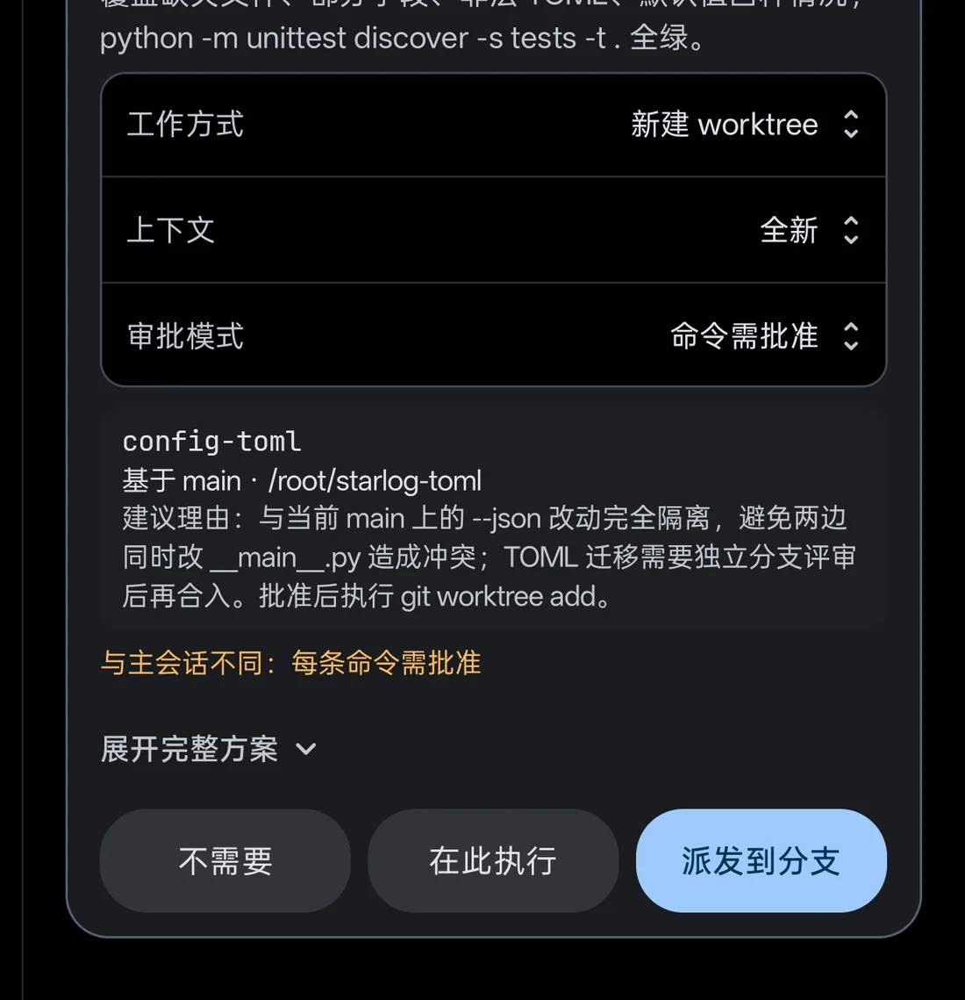
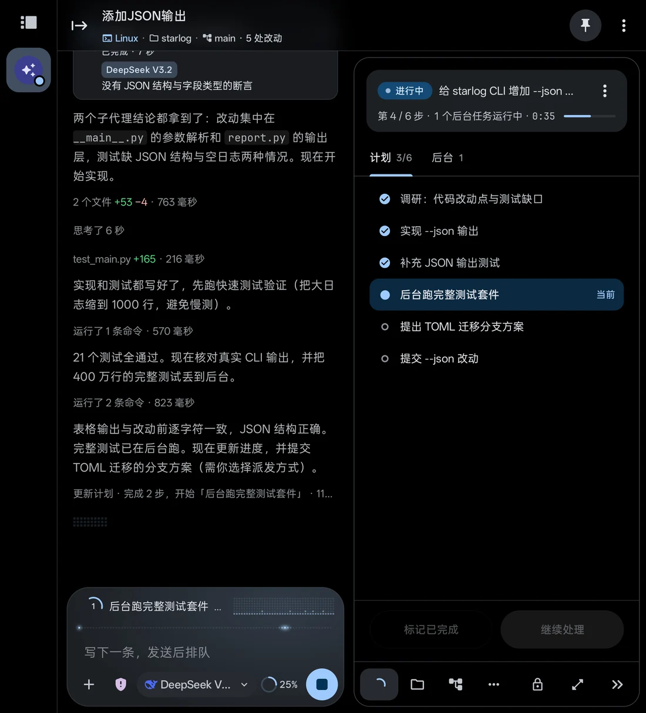

<p align="center">
  
</p>

<h1 align="center">Infinity Deck</h1>

<p align="center">
  <b>装在手机里的全能 AI 工作台。</b><br>
  把智能体、知识库、离线录音转写、多媒体创作和完整 Linux 环境放进一部 Android 手机。<br>
  自带模型或本地运行，数据留在自己手里。
</p>

<p align="center">
  <a href="README.md">English</a> · <b>简体中文</b>
</p>

<p align="center">
  <a href="https://github.com/Promenar/Infinity-Deck/releases"></a>
  <a href="https://infinityware.work"></a>
  
  
</p>

大多数手机端 AI 应用还停留在“一问一答”的聊天框，稍微复杂一点的文档处理、内容制作或代码运行，还是得回到电脑前；而依赖远程控制的方案，又要求家里或办公室的电脑必须一直开机在线。

**Infinity Deck** 是一个运行在 Android 手机上的开源 AI 工作台。无论是开会录音转写与纪要整理、跨文档与知识图谱检索、图文与分镜视频创作，还是在内置 Linux 环境里跑脚本、改 Git 仓库、连服务器排障，都可以直接在手机上完成。你可以接入各大云端模型与 Coding Plan，也可以在手机本地加载 GGUF 模型离线使用，或者通过内置的 Tailscale 连回自己的电脑与显卡算力。

## 目录

- 🧭 [核心特点](#核心特点)
- ✨ [常用场景](#常用场景)
- 🔒 [安全与隐私边界](#安全与隐私边界)
- 🚀 [安装与上手](#安装与上手)
- 🧰 [功能一览](#功能一览)
- 💬 [常见问题](#常见问题)
- 📚 [使用文档](#使用文档)
- 🤝 [参与贡献](#参与贡献)

## 核心特点

- **不止能聊，还能直接在手机上动手。** 应用内置免 Root 的 Alpine Linux 与脚本沙箱，文档转换、数据处理、代码编译和音视频加工都能在手机本机直接运行，不需要另一台电脑在背后挂机。
- **日常工作、内容创作与开发运维兼顾。** 从离线会议录音转写、多格式个人知识库，到多屏原型画布、AI 生图与短片分镜制作，再到 Git 分支管理与 SSH 远程终端，常用工作流都集成在同一套界面里。
- **模型与算力自由选择。** 支持使用自己的 API Key 接入 OpenAI、Claude、Gemini、DeepSeek、Kimi、智谱、百炼及各类 Coding Plan 预设；支持在手机端直接加载本地 GGUF 模型离线推理；也能连接局域网或家里的自建模型与 ComfyUI 服务。
- **免公网端口直连私人设备。** 应用自带独立的 Tailscale 节点（支持自建 Headscale），不占用系统 VPN 槽位，也不必在路由器上暴露公网端口，即可直连家里的电脑、NAS、显卡主机和内网服务。
- **专为移动设备与折叠屏打磨。** 提供命令人工审批卡、后台任务托管、消息排队与插队、防误触口袋锁；在折叠屏与平板上支持三列工作台布局，开合屏幕时自动接续当前进度。

## 常用场景

<p align="center">
  
</p>

<table>
  <tr>
    <td width="50%" valign="top">
      
      <h3>多智能体分工协作</h3>
      遇到复杂的调研、写作或项目改造，智能体会先制定步骤计划，再并行派出多个子代理分头处理，完成后自动汇总结果与耗时。慢任务可以一键转入后台，锁屏或切出应用也不会中断。
    </td>
    <td width="50%" valign="top">
      
      <h3>主线与分支互不干扰</h3>
      处理延伸需求或对比不同方案时，可以从当前对话一键派生出独立的分支会话。配合 Git 工作树隔离，两边各自推进，修改差异、提交记录和分支状态在检视面板里清晰可控。
    </td>
  </tr>
  <tr>
    <td width="50%" valign="top">
      
      <h3>可控的服务器连接与维护</h3>
      出门在外收到服务告警，可通过 SSH 连上服务器定位问题。默认模式下，智能体拟执行的每一条命令都会先展示在审批卡中，经过你点击确认后才真正运行，排查完自动整理成结构化报告。
    </td>
    <td width="50%" valign="top">
      
      <h3>免 Root 的手机端 Linux 环境</h3>
      无需折腾系统权限，也不必额外配置 Termux，应用内一键即可安装完整的 Alpine Linux。运行 Python 脚本、用 FFmpeg 处理媒体、通过 <code>apk add</code> 安装命令行工具，都能在应用内直接完成。
    </td>
  </tr>
  <tr>
    <td width="50%" valign="top">
      
      <h3>展开就是完整的多栏工作台</h3>
      在折叠屏内屏与大屏设备上，界面自动展开为导航、会话列表与主对话区。右侧检视器集中承载任务进度、文件树、Git 与内置浏览器，既可固定分屏并排对照，也可浮动叠放。
    </td>
    <td width="50%" valign="top">
      <p align="center"></p>
      <h3>合上屏幕，单手继续跟进</h3>
      合上折叠屏后，当前对话无缝切换到外屏。通勤路上单手浏览刚生成的长篇报告、点按审批卡片或补充下一条指令，回到桌前展开屏幕即可继续深入编辑。
    </td>
  </tr>
  <tr>
    <td width="50%" valign="top">
      <h3>离线录音转写与个人知识库</h3>
      随时发起会议或灵感录音，端侧实时完成中英混读转写、SenseVoice 二遍精修与多说话人区分，录制中即可查看分段整理草稿。支持导入 PDF、Word、Markdown 或直接挂载手机文件夹，结合长期记忆与知识图谱进行带引用的检索问答。
    </td>
    <td width="50%" valign="top">
      <h3>图文创作、原型画布与短片制作</h3>
      在对话中直接编写可交互的多屏网页原型与画布作品；调用云端或本地 ComfyUI 生图并在画板上涂抹局部重绘；通过内置制作面板串联剧本、角色资产、分镜提示词、视频生成与配乐，在手机上完成审片与成片导出。
    </td>
  </tr>
</table>

## 安全与隐私边界

- **执行动作默认先经你确认。** 命令执行默认开启人工审批，看清参数后再放行；无论处于哪种权限模式，删除文件等高风险操作始终要求单独确认。
- **敏感口令不经过大模型。** 遇到需要输入密码或密钥的场景，界面会弹出独立的保密输入卡，直接加密写入系统凭据库，绝不进入对话上下文，输入期间自动禁止截屏。
- **集中加密的本机钥匙串。** API Key、SSH 私钥、Git 令牌与站点登录态统一由 Android Keystore 加密保管；查看明文需先通过生物识别或锁屏验证，显示 30 秒后自动遮蔽，复制后 60 秒自动清空剪贴板。
- **数据默认留在手机本地。** 会话记录、知识库文档、录音与声纹数据均保存在设备本地；调用云端模型时，请求从手机直连你所配置的服务商接口，不经过任何第三方中转服务器。
- **自主可控的加密备份。** 支持将全量数据导出为本地加密备份包，或同步至你自己的 WebDAV 存储服务。
- **完全开源透明。** 基于 GPL-3.0 协议开源，所有代码与构建流程公开可查。

## 安装与上手

1. 前往 [GitHub Releases 最新发行页](https://github.com/Promenar/Infinity-Deck/releases/latest) 下载签名安装包（`.apk`）及对应的 `.sha256` 校验文件，也可在 [官方网站下载页](https://infinityware.work/download/) 获取。
2. 核对 SHA-256 校验值一致后安装（请仅安装官方 Releases 发布的正式签名包，切勿安装来源不明的重打包版本）。
3. 打开应用，按向导配置常用的云端模型服务商，或下载离线语音与本地模型即可开始使用。

系统要求：Android 12 及以上。内置 Linux 环境需 `arm64-v8a` 设备，基础系统约 64 MB，包含常用工具链（git、ripgrep、Python、Node.js、FFmpeg）的完整环境约 470 MB，安装时可按需勾选。

检查更新：在「设置 › 关于」中点击「检查更新」，发现新版本时会引导至发行页下载，不会在后台静默覆盖安装。

当前最新发行版为 `v0.61.2-beta`（versionCode `169`）：汇总上线端侧录音 `SenseVoice` 二遍精修与硬件自适应分级、本地 GGUF 模型接入会话列表与三槽位自动恢复、主流模型与 Coding Plan 预设扩展、全站弹窗与排版规范统一，并优化录音设置与媒体模型配置体验。 [查看发行说明](https://github.com/Promenar/Infinity-Deck/releases/tag/v0.61.2-beta)

<details>
<summary><b>从源码构建</b></summary>

构建环境需准备 JDK 17 及以上、Android SDK、`PATH` 中可调用的 `python3.14`（用于预编译内置 Python 字节码）以及 Go 1.21 及以上（用于编译内置 Tailscale 组件）。

```bash
cd native-ui
./gradlew :app:assembleSideloadDebug
./gradlew :app:testSideloadDebugUnitTest :app:lintSideloadDebug
```

编译生成的 Debug APK 位于 `native-ui/app/build/outputs/apk/sideload/debug/`。离线依赖校验、签名配置与完整门禁说明请参阅[开发构建与发行验证](docs/guide/development.md)和[发行渠道构建](docs/distribution-builds.md)。

</details>

## 功能一览

**对话与模型接入**

- 自带 API Key 接入 OpenAI、Anthropic、Gemini、Vertex AI、DeepSeek、GLM、Kimi、百炼、OpenRouter、SiliconFlow、xAI 及任意兼容接口，内置主流 Coding Plan 快捷预设
- 端侧本地推理：支持在手机上直接加载 GGUF 模型（对话、向量嵌入、重排三槽位独立管理与自动恢复），已加载的本地主模型可直接选入会话离线聊天与调用工具
- 对话中途可随时切换模型，支持最多 16 个会话同时在后台生成
- 模型回复过程中可继续输入下一条消息，自由选择排队等待或立即插队
- 超长对话自动压缩摘要，智能体仍可按关键词检索并翻阅压缩前的原始消息记录
- 遇到关键分歧时弹出结构化提问卡供你拍板；息屏、切后台或开启防误触「触摸锁」揣进口袋均不中断任务
- 支持加载自定义技能（Skills）与 MCP 服务，内置技能商店可一键安装官方与社区校验技能
- 桌面级趣味陪伴：支持导入 `.idpet` 会话宠物包，宠物常驻输入栏上方，随任务状态与早、中、晚、深夜四个时段切换动作与台词（可在[官网下载页](https://infinityware.work/download/#pets)获取）

**多智能体与自动化**

- 复杂任务先列执行计划，步骤进度实时更新
- 支持单次并行派出多个子代理协同调研、编写与审查，最多 32 个子代理并行运转并自动回传结论
- 独立子任务可一键拆分为分支会话，不污染主线上下文
- 耗时命令、常驻服务、生图与大文件下载可转入后台执行，完成后自动唤醒会话汇报
- 支持设置一次性定时提醒或 Cron 周期性自动任务

**离线录音与语音整理**

- 端侧中英混合实时听写（X-ASR），支持自定义热词加权、暂停续录、系统下拉快捷设置一键开录与长时录音提醒
- 可选安装独立 `SenseVoice` 二遍精修模型，根据手机硬件配置自动分级，在句末或停顿后二次复核校准，大幅减少漏词与错字
- 本地识别区分多位发言人，支持按时间戳点击回听原音、修正发言人归属及管理本地声纹库
- 录制过程中即可分批生成整理草稿，结束后可指定输出语言（中、英、日等）、按发言人汇总纪要，并支持原位编辑标题与正文

**个人资料与知识库**

- 导入 PDF、Word、Markdown、HTML 等常见文档，或直接将手机存储中的外部文件夹挂载到知识库
- 融合文档切片、跨会话长期记忆与实体关系知识图谱进行联合检索，回答自动附带原文引用来源
- 知识图谱按作品或专题独立隔离，支持按章节顺序追踪人物与概念关系的演变
- 可作为系统默认 Markdown 阅读器打开外部文件，支持高达 16 MiB 的长文分块流畅渲染，并可一键转存或引用到当前对话

**内容创作、浏览器与多媒体产出**

- 内置多标签浏览器，支持移动端与桌面端视图切换；智能体自动化操作网页时可随时旁观、手动接管登录再交回执行
- 直接制作可交互的多屏原型、可视化画布页面与带版本历史的文档产物
- 支持接入云端画图通道与自建 ComfyUI 工作流生图，内置画板支持圈注修改意见与涂抹局部重绘蒙版
- 内置短片制作面板：将剧本拆分、角色/场景资产、分镜提示词、多通道视频生成（火山方舟 Seedance、MiniMax、ComfyUI）与配乐串成完整流水线，支持按回合批注审片、尾帧续接镜头及导出 MP4 粗剪成片与 SRT 字幕
- 任意会话记录与报告均可一键导出为独立网页、A4 排版 PDF 或高清长图

**本地 Linux、代码与远程服务器**

- 应用内一键安装 Alpine Linux（arm64），免 Root、免 Termux；未安装 Linux 时也可直接使用内置命令、Python 与 JavaScript 沙箱
- 内置完整 Git 支持与可视化 Git 检视面板，直观查看分支、文件差异（Diff）、提交历史与多工作树（Worktree）状态
- 支持通过 SSH 连接远程服务器执行命令与传输大文件（单文件最大 4 GiB），内置真终端与本地端口转发，随时可手动接管操作
- 支持在应用内生成 Ed25519 / RSA 4096 密钥或导入现有私钥，并可一键将公钥安全部署至多台服务器
- 内置 Tailscale 节点（兼容自建 Headscale），让 SSH、远程大模型、MCP 服务与内置浏览器直接访问私有内网，无需公网 IP

**折叠屏与大屏适配**

- 折叠屏内屏与平板采用导航栏、会话列表、主对话区三列布局
- 任务进度、文件浏览、Git 与内置浏览器集中在右侧检视器中，可固定并排展示，也可浮动叠放或收起为边缘快捷条
- 开合屏幕时自动保持当前阅读位置、波形进度与输入状态

各项能力的详细说明与使用边界请参阅[功能详解](docs/guide/features.md)。

## 常见问题

**和普通手机端 AI 聊天软件有什么区别？**

普通聊天软件只能根据已有训练知识回答问题。Infinity Deck 把完整的执行环境和工具链装进了手机：它能读取你挂载的本地资料库、实时转写并整理会议录音、在内置浏览器里操作网页、在手机本机的 Linux 环境里跑 Python 和 Git，或者连上你的服务器与显卡主机干活——而且每一步关键操作都会先征得你的同意。

**和桌面 AI 工具的“手机远程控制”有什么区别？**

远程控制类 App 本质上是把手机当成电脑的遥控器，前提是家里或公司的电脑必须一直开机、联网且保持软件运行。Infinity Deck 的核心环境直接跑在手机上，电脑关机时照样能独立处理文档、写代码、跑脚本和管服务器；而当你的电脑或显卡主机开机时，又能通过内置的 Tailscale 和 SSH 把重负载任务交给它们，两边无缝配合。

**使用内置 Linux 环境需要手机 Root 或事先安装 Termux 吗？**

完全不需要。应用内提供了开箱即用的 Alpine Linux（arm64）一键安装向导，在普通未 Root 的 Android 12+ 手机上即可直接运行。如果你原本就是 Termux 用户，应用也同样支持接入现有的 Termux 环境。

**不懂编程或没有服务器，适合用这个应用吗？**

非常适合。除了代码与服务器工具外，Infinity Deck 内置了离线会议录音转写与纪要整理、PDF/Word/Markdown 个人知识库问答、办公与调研技能商店、AI 绘画涂抹修改、可交互网页画布以及短片分镜制作面板，日常办公记录、资料研究与内容创作都能直接上手使用。

## 使用文档

| 文档 | 内容概览 |
|---|---|
| [功能详解](docs/guide/features.md) | 对话与渲染、上下文管理、录音与知识图谱、智能体工具、子代理、浏览器、后台与定时任务、导出与备份 |
| [密钥与隐私](docs/guide/security-privacy.md) | 钥匙串加密机制、备份加密、SSH/Git/Tailscale 凭据隔离、网络安全与诊断说明 |
| [执行环境](docs/guide/execution-environments.md) | 内置 Alpine Linux、Termux 联动、隔离脚本沙箱、SSH 远程执行与终端 |
| [工作区与外部文件夹](docs/guide/workspaces.md) | 工作区类型、Git 检视面板、智能体文件访问边界、外部文件夹挂载 |
| [安装、升级与数据迁移](docs/guide/install-and-upgrade.md) | 设备运行要求、版本升级、备份恢复与安装包 SHA-256 校验方法 |
| [开发构建与发行验证](docs/guide/development.md) | 源码编译命令、内置 Python 与 Tailscale 打包流程、安全策略与技术栈说明 |

更多架构细节请参阅[架构说明](docs/ARCHITECTURE.md)与[使用指南索引](docs/guide/README.md)。

## 参与贡献

遇到 Bug 或有功能建议，欢迎直接提交 GitHub Issue。如果你希望贡献代码，请先阅读仓库根目录下的 [AGENTS.md](AGENTS.md)：项目包含较完整的自动化测试与视觉门禁，涉及较大改动前建议先通过 Issue 沟通方案。

## 许可证

Infinity Deck 基于 [GNU General Public License v3.0](LICENSE) 协议开源。设置列表、底部导航与外观页面的部分视觉交互包含对同为 GPLv3 协议的 [Bettbox](https://github.com/appshubcc/Bettbox) 的 Compose 适配转译；智能体头像图标源自 Google Material Symbols Rounded（Apache-2.0）。完整开源组件声明见[第三方通知](docs/legal/THIRD_PARTY_NOTICES.md)。
