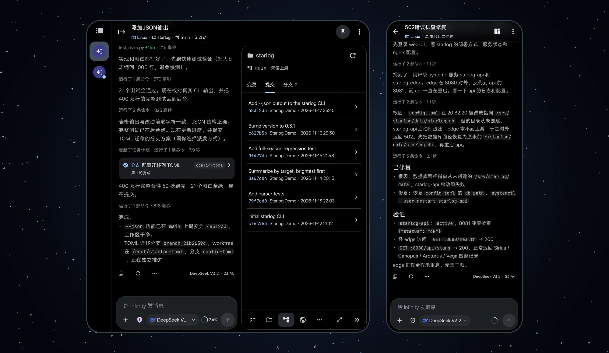
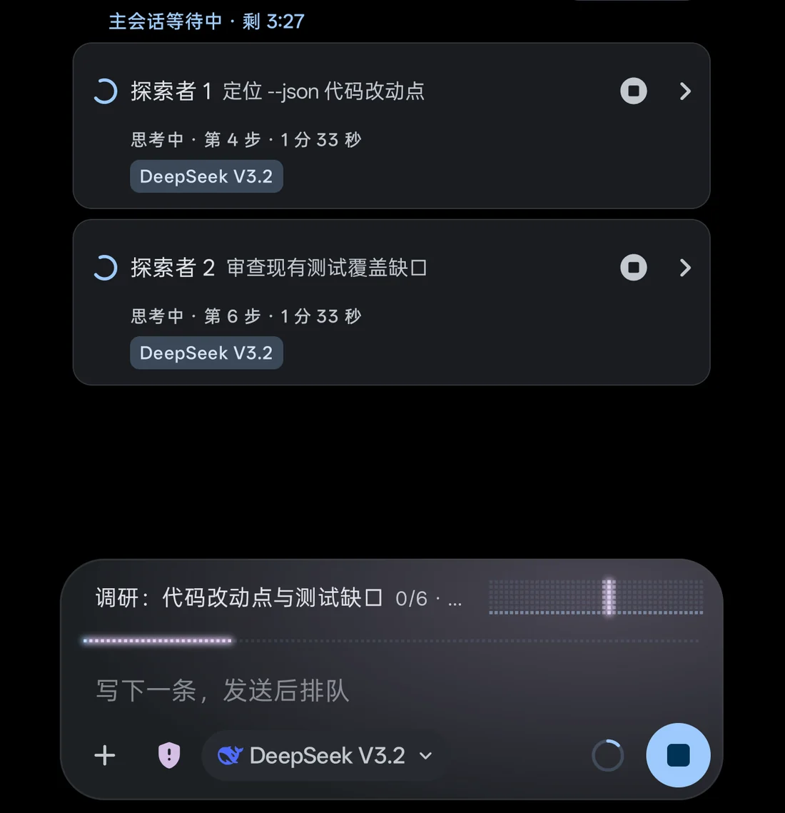
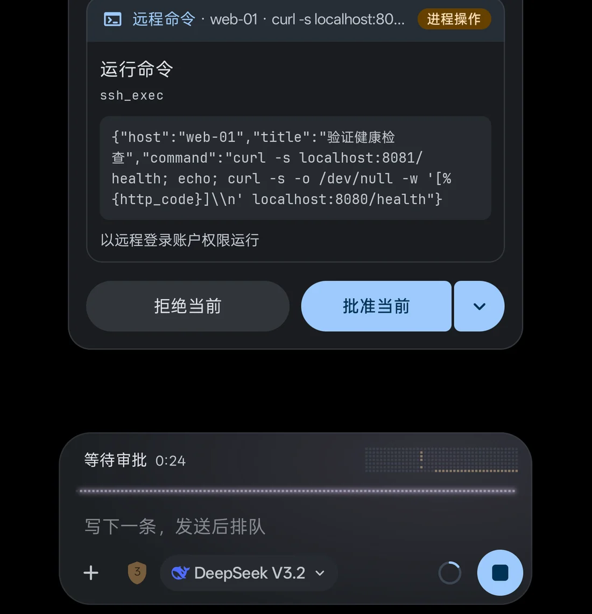
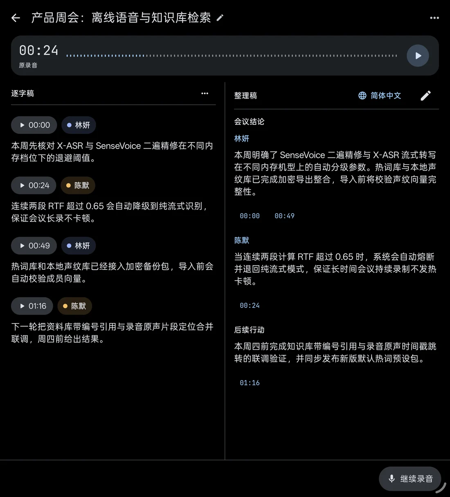

<p align="center">
  
</p>

<h1 align="center">Infinity Deck</h1>

<p align="center">
  <b>运行在 Android 上的开源本地优先 AI 智能体工作台。</b><br>
  集成 Alpine Linux 容器、Git、SSH、嵌入式 Tailscale、端侧语音与 GGUF 推理、混合 RAG 知识库及多媒体制作流水线。<br>
  自带 API Key 或本地模型运行，数据与凭据保存在本机。
</p>

<p align="center">
  <a href="README.md">English</a> · <b>简体中文</b>
</p>

<p align="center">
  <a href="https://github.com/Promenar/Infinity-Deck/releases"></a>
  <a href="https://infinityware.work"></a>
  
  
</p>

**Infinity Deck** 是一个面向 Android 12+ 的开源 AI 工作台，将多智能体编排、本机代码与命令执行环境、私有网络接入、离线语音转写、文档知识库与音视频生成工具整合在单应用中：

- **本地执行层**：内置免 Root 的 Alpine Linux（`arm64-v8a`，含 git、ripgrep、Python、Node.js、FFmpeg）及内置 Python 3.14 / QuickJS / 精简 `arm64-v8a` FFmpeg 与 ffprobe 工具链，可在设备端直接运行脚本、处理音视频、构建项目与转换文件，不依赖远程桌面主机在线。
- **模型与端侧推理**：支持通过自有 API Key 接入主流大模型服务商与各类 Coding Plan 接口；内置基于 `llama.cpp` 的 GGUF 本地推理引擎（支持主对话、Embedding、Rerank 三槽位与 `16K / 8K / 4K` Prefix KV Cache）及基于 `sherpa-onnx` 的离线语音管线（X-ASR 流式转写、SenseVoice 二遍校准、说话人分段与声纹识别）。
- **私有网络与远程运维**：内置用户态 Tailscale 节点（兼容自建 Headscale），不占用 Android 系统 VPN 槽位，使 SSH、私有模型端点、ComfyUI、MCP 服务与内置浏览器直达 `tailnet` 内网。
- **知识库与创作工作台**：支持外部目录挂载与 `read_only / read_write` 分级受管读写、文档切片检索与实体知识图谱查询、离线录音富格式整理（表格 / Mermaid / ECharts / LaTeX 与长图 PNG/PDF 导出）、可交互多屏网页画布、图像局部重绘，以及集成离线 `Three.js` 3D 白模预演与剧本/资产/分镜/粗剪导出的制作面板。

## 目录

- 🧭 [架构与运行特性](#架构与运行特性)
- ✨ [核心工作流](#核心工作流)
- 🔒 [安全与数据边界](#安全与数据边界)
- 🚀 [安装与构建](#安装与构建)
- 🧰 [功能清单](#功能清单)
- 💬 [常见问题](#常见问题)
- 📚 [技术文档](#技术文档)
- 🤝 [参与贡献](#参与贡献)

## 架构与运行特性

- **设备端独立运行**：命令执行、Git 仓库操作、文档解析与端侧推理均在手机本地完成；需要重算力时可通过 SSH 或 Tailscale 调用远端工作站与 GPU 主机。
- **多协议模型路由**：原生适配 OpenAI Responses / Chat Completions、Anthropic Messages、Google Gemini / Vertex AI 等协议，支持会话中途切换模型与单模型连通性测速。
- **无公网暴露内网直连**：内置 Tailscale 节点将应用内网络请求直接路由至私有 `tailnet`，无需配置公网端口映射或启用系统级 VPN。
- **人工回路（Human-in-the-loop）控制**：工具调用支持计划确认、逐条命令审批、结构化提问卡、后台任务队列与消息插队。
- **移动与大屏自适应布局**：支持单手审批、后台保活与防误触口袋锁；在折叠屏与平板上提供三列布局与可固定/浮动的右侧检视器，开合屏幕时保持会话与任务上下文连续。

## 核心工作流

<p align="center">
  
</p>

<table>
  <tr>
    <td width="50%" valign="top">
      
      <h3>计划拆解与并行子代理</h3>
      智能体在执行复杂任务前先生成步骤清单，并可并行派生多个只读或专项子代理（单会话最多 32 个并行，单批最多 8 个）分别执行代码检索、资料核对或测试审查，执行结果与耗时自动聚合回主会话。
    </td>
    <td width="50%" valign="top">
      
      <h3>Git Worktree 与分支会话隔离</h3>
      可将独立子任务派生为分支会话，并绑定单独的 Git Worktree 目录。主会话与分支会话在各自的工作树中并行修改代码与运行测试，通过内置 Git 检视器统一查看分支、Diff 与提交历史。
    </td>
  </tr>
  <tr>
    <td width="50%" valign="top">
      
      <h3>SSH 远程执行与逐条命令审批</h3>
      通过 SSH 连接远程主机排查服务异常。默认审批模式下，每一次远程命令调用均会展示目标主机、命令原文与权限说明，经人工确认后方可执行，并在完成后输出结构化排障记录。
    </td>
    <td width="50%" valign="top">
      
      <h3>内置免 Root Alpine Linux</h3>
      应用内一键部署 `arm64-v8a` Alpine Linux 用户态环境，无需设备 Root 或外部 Termux。可直接运行 Python、Node.js、FFmpeg、Git，或通过 `apk add` 安装所需命令行工具。
    </td>
  </tr>
  <tr>
    <td width="50%" valign="top">
      
      <h3>折叠屏三列工作台与检视器</h3>
      大屏与折叠屏内屏采用「导航 · 40dp 极简分支窄栏 / 会话列表 · 主会话」自适应结构。右侧检视器采用统一黑曜石熏黑毛玻璃与底缘横滑短标题轨道，集中承载任务进度、文件树、Git、内置浏览器、远程终端与制作面板，支持图钉固定或浮动叠放。
    </td>
    <td width="50%" valign="top">
      <p align="center"></p>
      <h3>开合屏状态无缝接续</h3>
      合上折叠屏后，当前活动会话自动迁移至外屏并保持滚动位置与输入状态，便于单手审阅输出、点击命令或锁审批卡片，以及从顶部悬浮通知胶囊快速处理状态提示。
    </td>
  </tr>
  <tr>
    <td width="50%" valign="top">
      
      <h3>端侧离线语音与录音整理</h3>
      内置离线流式听写（X-ASR）、可选 `SenseVoice-Small int8` 二遍精修（按设备内存与 CPU 自动分级，含 RTF 熔断退避）及本地说话人分离（pyannote + CAM++）。支持录制中生成整理草稿、富格式图表与公式整理稿、双栏「编辑 / 预览」、双向 CAS 同步 `/mnt/knowledge` 与 `1440px+` 单张 PNG/PDF 导出。
    </td>
    <td width="50%" valign="top">
      
      <h3>混合 RAG 资料库与知识图谱</h3>
      支持导入 PDF、Word、Markdown、HTML 或以 `read_only / read_write` 分级挂载目录，融合文档向量、关键词检索、跨会话长期记忆与实体知识图谱生成带编号引用的答案，一键定位高亮原文。
    </td>
  </tr>
  <tr>
    <td width="50%" valign="top">
      
      <h3>模型路由与端侧 GGUF 推理</h3>
      支持自有 API Key 接入主流云端模型与 Coding Plan 预设，内置 `llama.cpp` 引擎独立托管对话（Main）、向量嵌入（Embedding）与重排序（Rerank）三槽位并支持重启自动恢复，配合内置 Tailscale 直连私有模型网关。
    </td>
    <td width="50%" valign="top">
      
      <h3>画布原型、3D 白模预演与音视频制作面板</h3>
      支持生成可交互多屏网页原型、画板蒙版重绘与多图滑切查看器（1×–5× / 90° 旋转）；通过制作面板管理剧本、双模视觉参考资产、已锁定项 AI 改写审批、离线 `three.js` 3D 白模分镜预演（Beauty/Depth 抽帧与硬件 MP4 导出）及多通道生视频（Seedance、MiniMax、ComfyUI）粗剪合成。
    </td>
  </tr>
</table>

## 安全与数据边界

- **按风险分级审批与根目录硬拦截**：默认「按风险审批」档对经严格词法解析的零副作用只读命令自动免批，写/执行命令、文件删除与工作区外写入需确认；「免批准」档跳过常规 L1 动作，而技能、智能体配置、ComfyUI/SSH/定时任务等 L2 运行时管理在两档均始终逐次确认。针对系统根 `/`、共享存储根 `/sdcard`·`/storage/emulated/0`、应用数据根或未展开根目录变量的毁灭性命令在两档下均直接硬拦截，不弹审批卡。
- **凭据上下文隔离**：密码与令牌输入通过独立保密输入卡直接写入加密凭据库，不进入 LLM 上下文与聊天记录，显示期间启用 `FLAG_SECURE` 禁止截屏。
- **Android Keystore 钥匙串**：API Key、SSH 私钥、Git 令牌与站点凭据均加密存储；查看明文需通过系统生物识别或锁屏认证，展示 30 秒后自动隐藏，复制后 60 秒自动清理剪贴板。
- **本地存储与直连请求**：会话数据库、知识库索引、录音与配置均存储在设备本地；模型调用从客户端直接发往所配置的接口地址，无中间代理服务器。
- **加密备份导出**：支持导出本地加密备份包（含可选声纹与凭据恢复机制）或同步至 WebDAV。
- **开源许可**：采用 GPL-3.0 许可证开源。

## 安装与构建

### 安装预编译包

1. 从 [GitHub Releases](https://github.com/Promenar/Infinity-Deck/releases/latest) 或 [官方网站下载页](https://infinityware.work/download/) 下载签名 `.apk` 与同名 `.sha256` 校验文件。
2. 校验 SHA-256 摘要一致后安装（仅安装官方 Releases 签名包，勿使用 CI 临时构建产物或第三方重打包文件）。
3. 启动应用，在设置中配置云端模型 API Key，或按需下载内置 Linux、离线语音模型与本地 GGUF 模型。

- **运行要求**：Android 12（API 31）及以上。内置 Linux、端侧 GGUF 推理需 `arm64-v8a` 设备；Alpine 基础环境约 64 MB，含默认工具链（git、ripgrep、Python、Node.js、FFmpeg）约 470 MB，安装时可按需取消勾选。
- **应用更新**：通过「设置 › 关于 › 检查更新」查询 GitHub 最新 Release 并跳转下载，应用不会在后台自动下载或静默安装 APK。
- **当前版本**：`v0.72.0-beta`（versionCode `205`），将内置模式统一收口至唯一真实 Android 路径体系（文件工具、`shell_exec`、`python_exec` 与媒体存取共用真实规范路径与无前导 `/` 相对路径，仅无 POSIX 路径的 `/mnt/knowledge` 与 SAF 保留虚拟前缀），向文件工具开放关键运行时数据只读自诊断同时对加密密钥库 `infinity_encrypted_secrets.xml*` 实行读写全硬拒，上线 L1/L2 按命令风险分级审批模型（默认「按风险审批」含严格零副作用只读白名单，「免批准」跳过常规动作且保留 L2 管理审批），并在两档下内置不可审批的毁灭性根目录破坏硬拦截防线（`EXEC_BLOCKED_CATASTROPHIC_COMMAND`）。前序 `v0.71.6-beta`（`204`）统一内置 `arm64-v8a` FFmpeg/ffprobe `PATH` 符号链接并补齐 `infinity-deck` 运行时隔离契约；`v0.71.5-beta`（`203`）上线 ComfyUI 零硬编码全能提交器框架（10 类通用能力）、双执行环境自动切换（Linux / 内置 Python 3.14）、内置精简 `arm64-v8a` FFmpeg 9.1 / ffprobe + 8-bit `libx264`（`+2.69 MiB` APK 增量，16KB 页对齐，GPL-3.0）及 `STATEFUL_CHAIN` 3 处缺口闭合；`v0.71.0-beta`（`198`）在最新 GitHub 公开发行版 `v0.70.4-beta`（versionCode `196`）基础上落地独立 ComfyUI 兼容层与 14 个一等 `comfy_*` 工具。详细逐版记录见 [CHANGELOG.md](CHANGELOG.md) 与 [发行页面](https://github.com/Promenar/Infinity-Deck/releases)。

### 从源码构建

需要 JDK 17+、Android SDK（API 36 / Build Tools 36.0.0 / NDK / CMake 3.22.1）、`PATH` 中的 `python3.14`（预编译内置 Python 标准库与依赖字节码）以及 Go 1.21+（编译内置 Tailscale 动态库 `libnxtailnet.so`）。

```bash
cd native-ui
./gradlew :app:assembleSideloadDebug
./gradlew :app:testSideloadDebugUnitTest :app:lintSideloadDebug
```

Debug APK 输出路径为 `native-ui/app/build/outputs/apk/sideload/debug/app-sideload-debug.apk`。完整构建说明、离线依赖校验与发行门禁见[开发构建与发行验证](docs/guide/development.md)及[发行渠道构建](docs/distribution-builds.md)。

## 功能清单

**对话与模型层**

- 支持接入 OpenAI、Anthropic、Gemini、Vertex AI、DeepSeek、GLM、Kimi、百炼、OpenRouter、SiliconFlow、xAI 等服务商与任意兼容端点，内置主流 Coding Plan（OpenCode Go/Zen、百炼、智谱、Kimi、方舟）预设与端点/协议变体快切
- 端侧 GGUF 推理（`llama.cpp`）：支持 `MAIN`（对话与工具调用）、`EMBEDDING`、`RERANK` 三槽位独立管理与重启自动恢复；支持 `Q8_0` KV 缓存量化、跨轮前缀 KV 复用与按可用内存自适应 `16K / 8K / 4K` 上下文；已加载的主槽位模型动态注入会话模型选择器
- 支持会话中途切换模型，最多 16 个会话并发生成；生成期间支持下一条消息排队或插队打断，并支持对已发送用户消息就地编辑、重新生成或派生分支会话
- 上下文自动压缩后保留原文检索能力，智能体可按关键词搜索并分页调阅历史原始消息
- 全站采用黑曜石熏黑毛玻璃 / 冷白磨砂材质与「环境光」无模糊省电档，搭配顶部悬浮通知胶囊与常驻稳态交互控件；内置 2 MiB 分片滚动诊断导出与单会话轨迹追踪
- 支持结构化提问卡、后台前台服务保活、防误触触摸锁
- 支持 Skills 技能包与 MCP 服务器接入，内置技能商店可从官方或自定义源安装经校验的技能
- 支持导入 `.idpet` 会话宠物包（[官网下载](https://infinityware.work/download/#pets)），根据任务状态与四段作息切换动画与台词

**智能体与自动化**

- 任务计划管理与步骤状态跟踪
- 子代理并发调度：单会话最多 32 个并行子代理（单批最多 8 个），支持限流、断网与超时自动退避重试
- 支持派生分支会话并关联独立 Git Worktree
- 后台任务管理：慢命令、常驻进程、图像生成与媒体下载可转入后台（单会话最多 32 个），完成后自动唤醒会话回报
- 支持单次定时与 Cron 周期性任务调度

**本地运行环境与代码工具**

- 应用内一键安装 Alpine Linux（`arm64-v8a`），免 Root、免 Termux
- 未安装 Linux 时提供内置 Shell 命令、Python 与 QuickJS 隔离沙箱
- 内置 Git 客户端与可视化 Git 检视面板（分支、工作树、文件 Diff、提交记录）；文件浏览页直接展示当前分支与改动计数
- Git 凭据按单次命令注入环境变量，不写入仓库配置文件
- 支持分段读取最大 100 MiB 的大文本文件

**远程服务器与私有网络**

- SSH 远程命令执行与 SFTP 文件读写（单文件最大 4 GiB）
- 内置终端模拟器与本地端口转发，支持随时手动接管会话
- 钥匙串支持生成 Ed25519 / RSA 4096 密钥或导入 OpenSSH / PEM / PKCS8 私钥（含带口令私钥），支持公钥批量部署与切换前登录验证
- 内置 Tailscale 节点（支持自建 Headscale），SSH、模型端点、MCP 与内置浏览器直连 `tailnet`

**离线录音与语音整理**

- 端侧流式语音识别（X-ASR 中英），支持自定义热词加权、暂停续录、Android 快捷设置磁贴一键启动及每 30 分钟长录确认提醒
- 可选独立下载 `SenseVoice-Small int8` 二遍精修模型（237 MB），支持手机硬件自动评估分级（实时句末+兜底、停顿后精修、纯流式）与连续慢段 RTF > 0.65 运行时熔断退避
- 端侧说话人分段与声纹识别（支持本地声纹库管理与加密备份迁移），支持按时间戳回听与修正段落归属
- 录制期间分批生成整理草稿，支持指定输出语言（中、英、日等）与以 ECharts、Mermaid、LaTeX 公式及表格呈现富格式结构化整理稿，内置「编辑 / 预览」双栏或切换编辑；支持导出 `1440px+` 基准画布双向无上限 1:1 单张长图 PNG、自适应矢量 PDF、Markdown、HTML 与 TXT；支持录音列表多选与搜索结果批量删除
- 开启会话知识库访问授权后，智能体可在 `/mnt/knowledge` 安全读写录音整理 `.md`（双向 CAS 同步回录音工作台）并只读访问映射的 `.wav` 原始音频

**知识库与文档**

- 支持导入 PDF、Word、Markdown、HTML 等文档或通过 SAF / 真实路径挂载外部文件夹
- 混合检索（文档向量 + 跨会话长期记忆 + 实体知识图谱），回答附带引用溯源；图谱按作品隔离并支持按章节顺序查询关系演化
- 注册系统 Markdown 打开方式与分享入口，支持 16 MiB 以内大 Markdown 分块渲染、另存为或引用至会话

**浏览器、画布与多媒体产出**

- 内置多标签浏览器，支持移动/桌面 UA 切换、直连本地端口（如 `localhost:8888`）与 `tailnet` 内部站点；支持智能体操作旁观与人工接管
- 支持生成可交互多屏原型、画布页面与多版本产物
- 支持云端与 ComfyUI 图像生成，内置画板提供标注与局部重绘蒙版涂抹，配合全站多图滑切查看器（1×–5× 双指/双击缩放、90° 旋转）统一浏览参考图与生成结果
- 内置影视制作面板：管理剧本、双模视觉参考资产（多视角整卡 / 分张单视图）、分镜、视频候选与配乐，支持单入口审批、已锁定项 AI 改写逐次审批、按尾帧串联续接镜头、调用 ComfyUI 超分/补帧工作流、离线 `three.js` 3D 白模分镜预演（机位/自由观察、180° 轴线安全区与 Beauty/Depth 抽帧及硬件 MP4 导出），以及本机合成导出 MP4 粗剪与 SRT 字幕（兼容火山方舟 Seedance、MiniMax 与自建 ComfyUI）
- 会话内容支持导出为独立 HTML、A4 PDF 或长图

各模块的详细说明与限制边界见[功能详解](docs/guide/features.md)。

## 常见问题

**与纯 API 聊天客户端有什么区别？**

纯聊天客户端仅负责拼接上下文并渲染模型文本回复。Infinity Deck 在本机集成了 Alpine Linux 容器、Git、SSH、Tailscale 节点、浏览器自动化、混合 RAG 引擎与离线语音/大模型推理运行时，智能体可在授权范围内直接读写文件、执行命令、操作网页与管理远程主机。

**与桌面 AI 编程工具的手机端“远程控制”有什么区别？**

远程控制模式依赖桌面端宿主持续开机联网，手机仅作为视图转发器；纯云端沙箱则无法访问你的局域网、本地硬件与私有服务。Infinity Deck 的执行环境直接运行在手机本地，离线或电脑关机时可独立工作；当家里或机房的主机在线时，又可通过内置 Tailscale 与 SSH 调用远端算力。

**使用内置 Linux 需要 Root 权限或预先安装 Termux 吗？**

不需要。内置 Linux 为应用内一键安装的 Alpine Linux（`arm64-v8a` 用户态容器）。若设备上已安装 Termux，也可在设置中额外接入。

**详细使用文档包含哪些语言？**

仓库 README 与应用界面均提供中英文支持；`docs/guide/` 下的深入技术文档与架构说明目前以中文维护，欢迎提交翻译 PR。

## 技术文档

| 文档 | 内容 |
|---|---|
| [功能详解](docs/guide/features.md) | 对话与渲染、上下文管理、资料与图谱、Agent 工具、子代理、浏览器、后台与定时任务、制作面板、导出与备份 |
| [密钥与隐私](docs/guide/security-privacy.md) | 密钥存储、备份加密、SSH/Git/Tailscale 凭据边界、网络安全、诊断事件 |
| [执行环境](docs/guide/execution-environments.md) | 内置 Alpine Linux、Termux、隔离脚本运行时、SSH |
| [工作区与外部文件夹](docs/guide/workspaces.md) | 工作区类型、Git、智能体可达范围、文件夹挂载 |
| [安装、升级与数据迁移](docs/guide/install-and-upgrade.md) | 运行要求、数据迁移、数据库版本链、APK 验真 |
| [开发构建与发行验证](docs/guide/development.md) | 构建命令、打包 Python 与 Tailscale、富内容安全策略、图标、技术栈 |

另见[架构说明](docs/ARCHITECTURE.md)、[模型目录规范](docs/model-catalog.md)、[发行渠道构建](docs/distribution-builds.md)与[使用指南索引](docs/guide/README.md)。

## 参与贡献

欢迎通过 GitHub Issues 提交缺陷报告或功能建议。提交 Pull Request 前请先阅读 [AGENTS.md](AGENTS.md) 了解项目的代码规范、单元测试与截图/设备门禁要求；涉及较大架构或界面改动时建议先通过 Issue 讨论。

## 许可证

Infinity Deck 基于 [GNU General Public License v3.0](LICENSE) 发布。设置列表、底部导航与外观页包含对同为 GPLv3 的 [Bettbox](https://github.com/appshubcc/Bettbox) 视觉实现的 Compose 转译；智能体头像符号来自 Google Material Symbols Rounded（Apache-2.0）。详细来源与范围见[第三方通知](docs/legal/THIRD_PARTY_NOTICES.md)。
